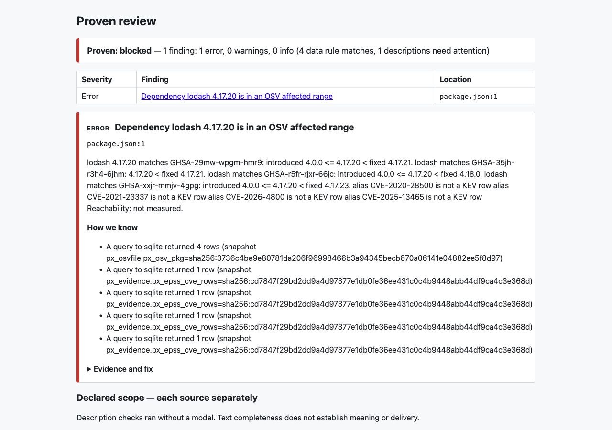
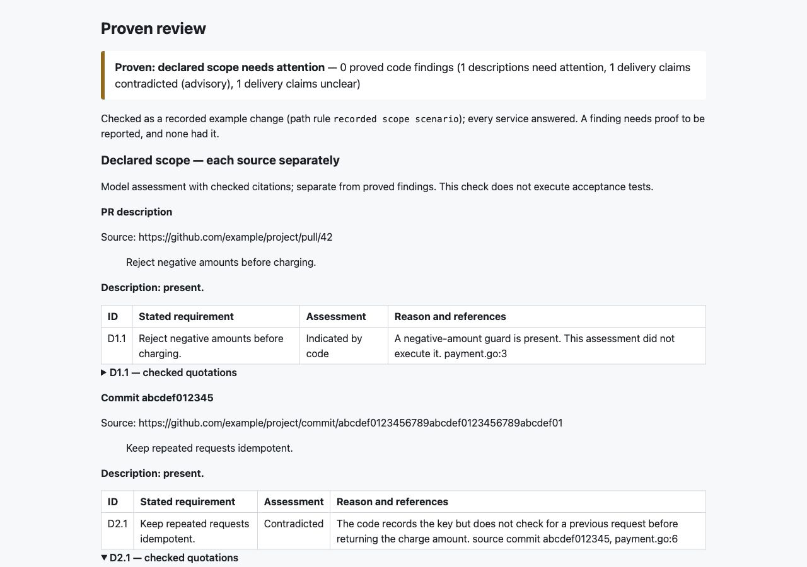
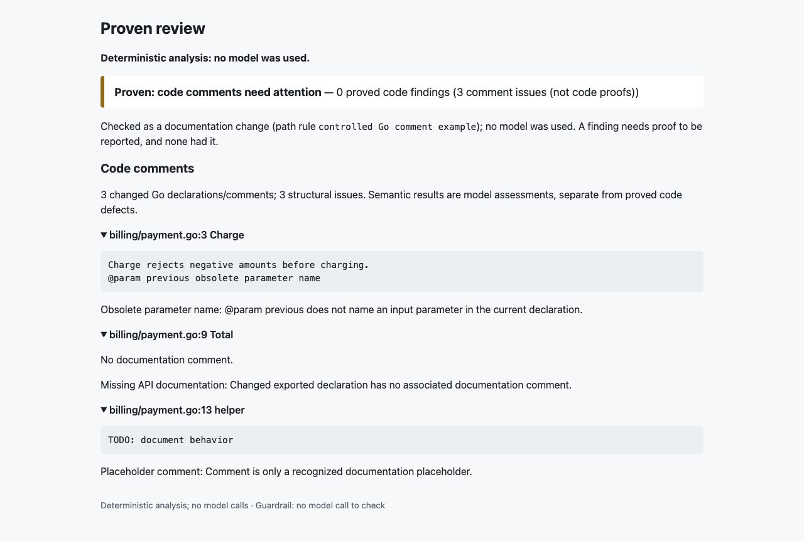
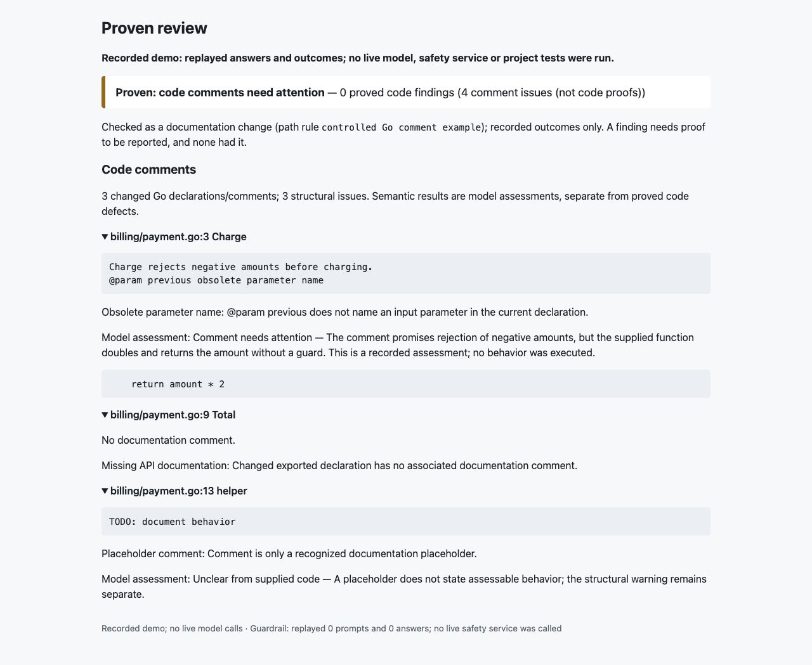
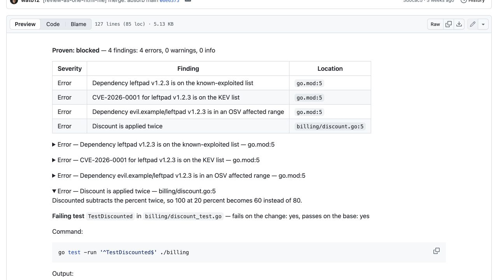

# Proven

**Review a change. See the evidence. Start without a model.**

Proven reviews Git changes and pull requests. It checks dependency risks against public data, runs deterministic rules, flags missing descriptions and produces readable reports. Connect a model when you want it to investigate code, propose regression tests and compare implementation with the scope people declared.

Proven started at the **Open Agent Hackathon 2026** and has since grown into an independent code review tool under active development. The [original hackathon version](https://github.com/saphan-ai/proven/tree/open-agent-hackathon-2026) is preserved on a separate branch.

**The code and documentation are written by coding agents, under human direction and review.** The [Proven effort report](https://saphan.ai/assets/research/proven-effort.pdf?v=20261031) describes the original build, its measured quality and the limits of those measurements.

**Development preview.** A complete review with no findings means the checks that ran proved no defect. It does not establish exhaustive coverage. Read [readiness and limitations](docs/READINESS.md) before making Proven a required check.

## Useful before you connect a model

No model account, model API key or vendor CLI is needed for the standalone image.



*Actual report from a controlled Git change adding `lodash 4.17.20`, using public source responses and zero model calls. [Full result and setup](docs/MODEL_FREE.md).*

| Without a model | With a model, additionally |
| --- | --- |
| Check added or upgraded dependencies against OSV; add known-exploitation and EPSS context. | Investigate risks in changed code. |
| Apply the registered malicious-package, project-health, CVSS and licence data rules. | Propose tests and run the same test against base and head to establish a regression. |
| Flag missing, placeholder and very short descriptions, separately for each source. | Compare each PR description, commit message and comment with cited implementation. |
| Check changed Go comments and public API documentation: missing docs, placeholders, naming conventions and stale parameter tags. | With comment review enabled, assess comment clarity, language and consistency with cited code. |
| Refresh public data before review and reuse unchanged records. | Propose fixes, then validate them through the same restricted runner. |
| Use configured deterministic tools, policy and JSON/SARIF/Markdown/HTML reports. | Add an independently configured second reviewer. |

Data observations are shown separately from proved code defects. Execution tools retain their own requirements: for example, the Go race detector needs Docker and a prepared Go/CGO test runtime. Model-free mode does not generate new tests. [What Proven checks and proves](docs/WHAT_PROVEN_CHECKS.md) explains each boundary.

### Try the standalone image

From a Git checkout with at least two commits:

```sh
docker run --rm \
  --mount "type=bind,src=$PWD,dst=/repo,readonly" \
  --mount type=volume,src=proven-data,dst=/work/.cache \
  -e PROVEN_GENERATOR_MODE=off \
  saphan/proven:latest scan --refresh-data --baseline-commit HEAD~1 /repo
```

This reviews the last commit, refreshes data for its dependency changes and checks its commit description. Change `HEAD~1` to your review base. The cache volume keeps downloaded public data between runs. Refresh sends dependency coordinates to the configured public providers; it does not upload your source code. Internet access is needed for refresh, not a model account.

[Run without a model](docs/MODEL_FREE.md) covers GitHub Actions, offline operation, reports and optional execution tools. To try the evidence flow without network or Docker, use the [recorded demo](docs/QUICKSTART.md).

To exercise actual Git/SQLite checks inside the image with **synthetic teaching data**, without a checkout, credentials, model or network:

```sh
docker run --rm --network none --entrypoint /bin/sh saphan/proven:latest /opt/proven/model-free-smoke.sh
```

## Does the code deliver what the PR and commits promise?

**Declared scope is review input. Each source gets its own findings.** Proven compares what was requested or claimed with the selected head code. It retains the original quote, source identity, commit SHA/comment link and checked code citations.



*Recorded teaching scenario with synthetic declarations/code and recorded model answers. The [full illustrated walkthrough](docs/PR_DELIVERY.md) also shows the separate comment results and a model-free placeholder warning.*

The PR description, every commit message and every discussion, review, inline or commit comment are assessed separately. Identical claims in two comments remain two records. Contradictory requests stay visible; a later comment does not silently erase an earlier one. A failed assessment leaves the other results intact.

Illustrative result, not a measurement of a live PR:

| Source | Declared scope | Result |
| --- | --- | --- |
| PR description | “Reject negative amounts before charging.” | **Indicated by code** — a guard is present, with checked lines. |
| Commit message | “Keep repeated requests idempotent.” | **Contradicted** — cited code appears inconsistent with the claim. |
| PR comment | “Handle empty amounts without throwing.” | **Unclear** — the supplied context does not settle the behavior. |
| Another commit message | “fix” | **Placeholder description** — detected without a model. |

A model's interpretation is an assessment, not executable proof. A defect backed by a differential test remains a separate proved finding. Description completeness is a mechanical check; it does not claim to understand the text.

Add `check-delivery: true` to the [GitHub Action](docs/ACTION.md) or [CLI Action](docs/START.md). Without a model it checks descriptions. With a model it also assesses each source against code. One summary comment contains separate sections; the full JSON and HTML keep every collected source, including incomplete ones.

[See the illustrated scope walkthrough](docs/PR_DELIVERY.md) for screenshots, statuses, source collection, limits and a complete setup.

## Code comments: structure and meaning

Comments can drift as code changes. Proven's **Go comment adapter** checks changed declarations and comments without running project code. Missing API docs, documentation placeholders and obsolete parameter tags remain separate from code defects.



*Actual Go AST checks on synthetic example source, with no model calls.*

With a connected model, set `PROVEN_CODE_COMMENTS=model` to add assessment of clarity, language and consistency with the associated code. Each comment keeps its own result and checked quotation.



*The same structural checks plus recorded model answers, passed through the real assessment/citation validator. This is a labelled teaching replay, not a live quality benchmark or executed proof.*

[Comment review setup, limits and adapter extension](docs/CODE_COMMENTS.md). Go is supported today; the extension and language tables below show where additional comment adapters fit.

## Data sources available today

`--refresh-data` refreshes the relevant data before a run. OSV's modified timestamps select new or changed advisory records; conditional HTTP requests reuse unchanged catalogues where supported. Providers without a delta endpoint are checked again and their small responses compared with the cache. The report distinguishes **when Proven checked a provider** from **when that provider measured or published its data**.

| Source | What it contributes | Automatic acquisition |
| --- | --- | --- |
| **OSV** | Advisory ranges for the selected package versions. | OSV API, advisory-ID/modified-time delta cache. |
| **CISA KEV** | Whether an affected CVE is known to be exploited. | CISA-maintained catalogue mirror, conditional refresh. |
| **FIRST EPSS** | Dated exploitation-probability scores for relevant CVEs. | FIRST API, scoped CVE requests. |
| **Malicious-package advisories** | Package-level warnings from `MAL-` records. | Relevant OSV/OpenSSF advisory records. Version applicability is checked separately by OSV. |
| **OpenSSF Scorecard** | Available maintenance and release-signing observations. | Project mappings and Scorecard data through deps.dev. |
| **CVSS** | Reported CVSS v3 severity scores, attached to known CVE identities. | deps.dev advisory metadata. |
| **Package licences / SPDX identifiers** | Reported package-version licence metadata and the existing licence rule. | deps.dev; the SPDX identifier list alone is not a package licence database. |

Provider coverage varies. Missing licence/project measurements are reported; no measurement is not a healthy result. Failed refreshes retain existing tables and make the requested refresh incomplete. New and withdrawn records are reconciled with the current review scope. [Source refresh](docs/SOURCE_REFRESH.md) explains provenance, cache behavior and supported providers; [source rules](docs/SOURCES.md) explains what each observation establishes.

## Supported languages in this version

| Language | Generated tests and fix validation | Dependency checks | Code comments |
| --- | --- | --- | --- |
| **Go** | Native `go test` | Go modules | Go AST: structural checks; optional model assessment. |
| **Python** | pytest, including unittest-style tests | PyPI / requirements and Poetry locks | Not yet available. |
| **TypeScript** | Vitest, including TSX | npm manifests and lockfiles | Not yet available. |
| **JavaScript / Node.js** | Native `node:test` or Vitest | npm manifests and lockfiles | Not yet available. |
| **PHP** | Not yet available | Composer / Packagist | Not yet available. |
| **Rust** | Not yet available | Cargo / crates.io | Not yet available. |
| **Kotlin** | Not yet available | Gradle Kotlin DSL, version catalogs and lockfiles / Maven | Not yet available. |

Generated tests run in restricted containers; prepare the selected framework and offline dependencies. [Language coverage](docs/LANGUAGES.md) lists test naming, parser limits and the shared proof/fix contract. Feed acquisition coverage is separate: deps.dev does not supply every ecosystem's package metadata.

## Missing a language or data source? Add an adapter

Proven's models, manifest readers, test runners, tools, sources and stores sit behind adapters. Extend the relevant adapter and keep the review, evidence and reporting paths shared.

| You want to add… | Implement | Start here |
| --- | --- | --- |
| A dependency ecosystem | Manifest/lock readers and precise version comparison. | [Language adapter guide](docs/ADAPTERS.md#adding-a-language), with PHP and Kotlin examples. |
| Generated-test support | Fixed command construction, native result parsing, staging, base/head comparison and fix rechecks. | [Test-run adapter](docs/ADAPTERS.md#adding-a-test-run) and [current language registry](internal/testrun/languages.go). |
| Code comments for another language | Implement `codecomments.Adapter`: parsed associations, exact source excerpts, stable identities and language fixtures. | [Comment adapter guide](docs/CODE_COMMENTS.md#add-another-language), starting with the Go AST adapter. |
| Another data source | Acquisition/provenance, registered query templates, deterministic evidence rules and failure tests. | [Source adapter guide](docs/ADAPTERS.md#adding-a-source) and [refresh connectors](docs/SOURCE_REFRESH.md#adding-a-connector). |
| A deterministic analyzer | File applicability, controlled arguments and structured result comparison. | [Tool adapter example](docs/ADAPTERS.md#adding-a-tool). |
| Another model or database | Implement the existing transport/store interface. | [Model adapters](docs/ADAPTERS.md#adding-a-model-provider), [database adapters](docs/DATABASES.md). |

Adapters are repository code, with tests and controlled registration; there is no runtime marketplace or arbitrary command loader. [Runnable examples](examples/README.md) work without accounts. Selected core packages and their tests can also be taken into another reviewer without initializing the whole application.

Comment inspection has its own language adapters. The initial implementation uses Go's AST; test-run or dependency-reader support alone does not imply comment-analysis support. [Code comment checks](docs/CODE_COMMENTS.md) covers deterministic rules, optional linguistic review, exact scope and extending the adapter.

## Connect a model when you want deeper review

Use an OpenAI-compatible API, or an authenticated CLI account you already have. Vendor CLIs and login profiles are customer-provisioned. Proven's public image contains neither licensed vendor CLIs nor your account state.

**[Start with your own CLI](docs/START.md)** covers Claude Code, GitHub Copilot, Codex, Cursor and Qwen Code, on GitHub-hosted or your own runners. [Connect an API](docs/CONNECT_API.md) covers endpoints and keys. [Use two reviewers](docs/TWO_MODELS.md) keeps their connections and profiles separate.

### What we use internally

These are examples from our own work, **not a ranking, minimum specification or comparative benchmark**. Names reflect the models/environments we use; they are not universal API identifiers or a guarantee of access through your account.

| Model | Context |
| --- | --- |
| Anthropic Claude Sonnet 5.5 | Internal development and review workflows. |
| Anthropic Claude Opus 5.5 | Internal security review and development of large changes. |
| OpenAI GPT-6 Sol | Internal security review and development of large changes. |
| xAI Grok 4.7 | Internal work. |
| [NVIDIA Nemotron 3.5 Super VL 120B-A12B](https://build.nvidia.com/nvidia/nemotron-3.5-super-vl-120b-a12b/modelcard) | Internal development and review. |
| [Z.ai GLM-5.3](https://z.ai/company) | Used in the original hackathon project. |

Model capability, context and configured limits can affect which risks and tests are proposed. Executable evidence still decides proved findings. We plan broader comparative testing before publishing project-to-model recommendations. [Model configuration](docs/MODELS.md) explains tokens, timeouts, reasoning, recovery and reported model identity.

## Security: optional model safety checks

You can enable a safety guardrail around model calls. Proven checks the **prompt before sending it** to the reviewer and the **answer before an agent uses it**. An unsafe verdict or unavailable check stops that model step and remains visible in the report.

The guardrail adapter supports NVIDIA-hosted content-safety models and compatible self-hosted endpoints. NVIDIA's [NemoGuard content-safety models](https://docs.nvidia.com/nim/llama-3-1-nemoguard-8b-contentsafety/latest/index.html) can also be used in the [NeMo Guardrails ecosystem](https://docs.nvidia.com/nemo/guardrails/latest/configure-guardrails/guardrail-catalog/content-safety). Proven uses a direct safety-model API adapter; configure a deployed model and verify its response contract.

```yaml
env:
  PROVEN_GUARDRAIL_MODE: nvidia
  PROVEN_GUARDRAIL_MODEL: ${{ vars.PROVEN_SAFETY_MODEL }}
  PROVEN_GUARDRAIL_KEY: ${{ secrets.PROVEN_SAFETY_KEY }}
```

Safety checks are optional and off by default. Your reviewer can use another vendor or a customer-owned CLI; the safety service has its own configuration. Hosted checks send the prompt/answer content to that service. Runner isolation, validated queries, resource limits and secret filtering remain independent controls. [Guardrail setup and security boundaries](docs/GUARDRAILS.md).

## See the reports

[GitHub Actions, comments and expandable evidence](docs/GITHUB_TOUR.md) shows actual workflow/comment screenshots and a labelled recorded finding.



*Recorded sample rendered by GitHub, with synthetic data and replayed test outcomes.*

Reports are available as JSON, SARIF, Markdown, text and standalone HTML. Signed evidence packs support offline inspection. `proven verify` checks the signed recording and re-derives recorded decisions; it does not rerun tests or certify exhaustive coverage.

## Try the recorded demo

With Docker installed, run this from any directory — no clone, compilation, API key or mounted files:

```sh
docker run --rm --network none saphan/proven:latest scan --sample /opt/proven/fixture/discount
```

Docker downloads the ready-made image if needed. The demo itself runs without network access and shows recorded findings with their evidence. It uses synthetic example data and replayed outcomes; it does not review your project or execute new tests.

### Save the demo as HTML, JSON or SARIF

Save a report directly from the ready-made image:

```sh
docker run --rm --network none saphan/proven:latest scan --sample --html /opt/proven/fixture/discount > proven-demo.html
docker run --rm --network none saphan/proven:latest scan --sample --json /opt/proven/fixture/discount > proven-demo.json
docker run --rm --network none saphan/proven:latest scan --sample --sarif /opt/proven/fixture/discount > proven-demo.sarif
```

Open `proven-demo.html` in your browser. JSON is the full structured report; SARIF is suitable for compatible code-scanning tools. These commands run the recorded demo separately for each format.

To write **all three files from one run** (macOS/Linux shell):

```sh
mkdir -p proven-reports
docker run --rm --network none \
  --user "$(id -u):$(id -g)" -e HOME=/tmp \
  --mount "type=bind,src=$PWD/proven-reports,dst=/reports" \
  saphan/proven:latest scan --sample \
  --html-output /reports/proven-demo.html \
  --json-output /reports/proven-demo.json \
  --sarif-output /reports/proven-demo.sarif \
  /opt/proven/fixture/discount
```

The files appear in `proven-reports` on your machine. The same output flags work for a real review of your own checkout; see [output formats](docs/OUTPUT_FORMATS.md).

### From source (optional)

```sh
go build -o bin/proven ./cmd/proven
make sample
```

Use the Go version in [go.mod](go.mod). Sample mode replays recorded answers and outcomes without accounts, model keys, network or a container runtime. Follow the [quick start](docs/QUICKSTART.md), [evidence walkthrough](docs/WALKTHROUGH.md) or real [Git/SQLite tutorial](docs/DATA_WALKTHROUGH.md).

## Guides and development

For language models: [product facts and guide index](llms.txt). The documentation build also generates `/llms.txt` and `/llms-full.txt` from every rendered page.

The [documentation map](docs/README.md) links installation, policy, operations, database adapters, observability, fixes, extensions and limitations. SQLite is the default store; PostgreSQL, CouchDB, local files and Zetaris remain adapters. Bounded planning (Markovian), Scout Intent, memory and world state remain available with explicit switches; their effect on review quality needs further evaluation.

```sh
go test ./...
go vet ./...
make check-links
```

See [Contributing](CONTRIBUTING.md), [container builds and publication](docs/CONTAINERS.md) and [the roadmap](ROADMAP.md). Report vulnerabilities through [GitHub private vulnerability reporting](https://github.com/saphan-ai/proven/security/advisories/new).

Code: [Apache-2.0](LICENSE). Documentation: [CC BY 4.0](LICENSE-docs).
