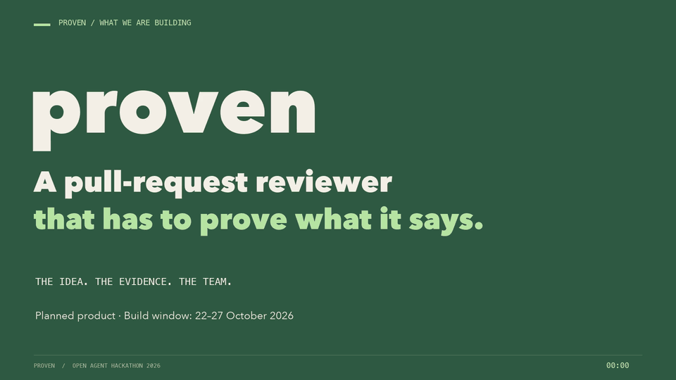

# Proven

**A code reviewer that has to show its evidence, built in public by one person and a fleet of AI coding agents.**

Proven will review pull requests: proposed changes to a codebase. Every problem it reports must come with evidence you can check yourself, such as a test you can run or a data query you can repeat. If it cannot show the evidence, it does not report the problem.

[Marcin "Wato" Marzec](https://wato.org/) used fleets of AI coding agents on commercial telco software, and built [Saphan Studio](https://saphan.ai/) to direct and check their work. Now he is taking that fleet to the [Open Agent Hackathon 2026](https://hackathon.genai.works/event/open-agent-hackathon-2026), organized by GenAI Works, from **22 to 27 October 2026**, in the track *The Agent That Can Explain Why*, to build Proven. The agents write the code. Marcin sets the direction, makes the decisions, reviews the outcomes and approves every merge.

**Proven does not exist yet.** Its code is written only inside the build window. Everything before 22 October is preparation, and all of it is public.

<a href="https://vimeo.com/1236933110"><b>▶ Watch the introduction</b></a>: the idea, the evidence, the team (6 min). An introduction, not a product demo.

## Why this exists

Marcin has spent almost three decades in internet infrastructure and security, including products that run at mobile operators. When he began using fleets of AI coding agents on commercial telco software, the hard part was not getting code written. It was knowing what to trust: who asked for a change, who checked it, and on what evidence.

That work led to patent applications, filed in the U.S. and Europe and still pending, and to **[Saphan Studio](https://saphan.ai/)**: a product that runs fleets of coding agents under human authority and keeps the record of their work. Saphan Studio is itself built by one person working with an agent fleet. The agents develop the platform that governs their own work; Marcin decides what ships.

Now that fleet takes on something new. At the hackathon it will build **Proven**, an open-source tool for checking code of the kind it writes itself.

## Where things stand, 19 October 2026

The final warm-up before the start.

| what | status | where |
|---|---|---|
| Choosing the topic, with eleven answers from the fleet | done, 16 October | [answers](planning/answers/) |
| The design, as recorded decisions | 8 decisions accepted, 17–19 October | [decisions](fleet/decisions/) |
| Machines for the coding agents | planned: order drafted, not yet approved | [order](fleet/orders/TRAIN_ORDER_proven-cursor-infra.md) |
| A local NVIDIA safety model | planned: order drafted, not yet approved | [order](fleet/orders/TRAIN_ORDER_nemotron-content-safety.md) |
| Building Proven | starts 22 October, 00:00 UTC | |
| Public updates | daily, 15:00 UTC | this repository |

The preparation work sets up existing machines and tools for the agents. It is not product code, and it trains no models. Saphan Studio is a pre-existing component; the organizers confirmed that it may run the fleet.

## Why a tool like this is needed

One example from the fleet's earlier work, before Proven:

An agent wrote a protection against deleting the main branch of a repository, plus 16 tests to show it worked. All 16 passed. An independent reviewer then **removed the new protection** and ran the tests again. All 16 still passed: a different safeguard, in git itself, was stopping the deletions one step earlier. The tests proved git, not the fix. ([source](planning/answers/master-the-bridge-commits-without-a-shared-lock.md))

Passing tests do not always prove what they claim to prove. A reviewer that asks "what does this evidence actually show?" catches what a green checkmark hides.

## What Proven is meant to do

*Planned, not built. Each part is described as intended.*

- **Every finding carries evidence.** A test that fails on the change and passes without it, or a recorded query and its results, with sources. This applies to every finding, including when two reviewers agree. Agreement is never a substitute for proof.
- **The reviewer should come from a different AI model family than the one that wrote the code.** A reviewer from the same family tends to share the author's assumptions; another family can challenge them.
- **For special kinds of review, such as security, two independent reviews by different models.** In the fleet's own record, reviewers from two model families looked at the same change within 30 minutes 41 times, and reached different verdicts 31 times ([source](planning/answers/README.md)). That is an observation from one fleet, not a benchmark, but it shows why a second opinion is worth having.
- **When reviews conflict, the evidence decides, not a vote.** Both sides' evidence is examined: what it actually establishes, what it assumes, and whether it reproduces. What stays unresolved is reported as unresolved, and a person decides.

Proven will not prove a whole program correct or find every vulnerability. It makes each claim it does make checkable.

The technical design, including the sponsors' technology (Zetaris, Meterless, NVIDIA, Cursor), is in **[DESIGN.md](DESIGN.md)**.

## Who builds it

Two different groups of AI agents appear in this project. Do not mix them up:

| | who | what they do |
|---|---|---|
| **The fleet that builds Proven** | coding agents run by Saphan Studio, with Marcin | plan each change, write the code, test it independently, review it, and hand Marcin a decision |
| **The agents inside Proven** | Proven's own reviewers, once built | review someone else's pull request: plan, gather evidence, try to refute, judge, write the report |

In the fleet, four Cursor agents write the product code. Other agents plan the work, write tests separately from the code, and review each change without having written it. Marcin sets the goals, rules on scope, settles disputes the evidence cannot settle, and approves every merge. An agent can recommend; only he can approve. How the fleet is organized is explained in **[SAPHAN.md](SAPHAN.md)**.

## Follow the work

- **[The diary](planning/CONVERSATIONS.md)**: every conversation between Marcin and the fleet, day by day.
- **[Watch it being built, slice by slice](fleet/)**: from 22 October, each change arrives with the request that asked for it, the builder's report, the independent review and Marcin's decision.
- **[Design decisions](fleet/decisions/)**: what was decided, and why.
- **[What it costs](fleet/LEDGER.md)**: the recorded cost of every change, by model.

Every agent run records its model and the cost Saphan Studio measured for it. Where a cost was not measured, such as interactive planning sessions, or a share of a subscription the tools cannot read yet, the document says so and why. These figures are what the AI models cost; machines and human time are not included.

**Updates:** once a day at **15:00 UTC** (22:00 in Bangkok; 17:00 in Warsaw during the build week). The last push comes before submissions close on 27 October, 23:45 UTC.

**Contact:** Marcin Marzec, [marcin.marzec@wato.org](mailto:marcin.marzec@wato.org), [LinkedIn](https://www.linkedin.com/in/marcinmarzec).

## For technical readers

| | |
|---|---|
| [DESIGN.md](DESIGN.md) | Proven's design, the sponsors' technology, evidence sources, open questions |
| [SAPHAN.md](SAPHAN.md) | the platform that runs the fleet, its roles and vocabulary |
| [AGENTS.md](AGENTS.md) | the rules every agent follows in this repository |
| [planning/](planning/) | how the topic was chosen, and the fleet's answers |
| [fleet/](fleet/) | orders, reports, reviews, decisions and the cost ledger, with their templates |

**Pre-existing components:** [Saphan Studio](https://saphan.ai/) runs the fleet; it is not part of this submission and not in this repository. The [Meterless engine specifications](https://github.com/Meterless/Meterless) (Apache-2.0) are open source; we build to them and do not copy their reference code. Model providers, tools and data sources are listed as they are used.

Before publication Marcin reviews every document. Credentials, internal host names and private infrastructure details are blacked out, and each document says where.

**Licence:** Apache-2.0. See [LICENSE](LICENSE).
