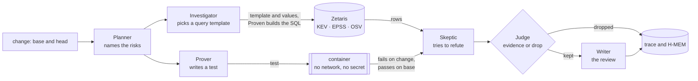

# Architecture

One page: the six agents, the order they run in, and what each one may and may not do. The reasons behind each choice
are in [DESIGN.md](../hackathon/DESIGN.md) and in the decisions under [fleet/decisions/](adr/).

## The pipeline

## The six agents

| Agent | Does | Never |
|---|---|---|
| Planner | reads the change and names candidate risks | reports a risk on its own |
| Investigator | picks one query template and its values per risk; Proven checks each value and builds the SQL ([QUERIES.md](QUERIES.md), [ADR-0032](adr/ADR-0032-proven-builds-every-query-from-a-template.md)), run through Zetaris | writes SQL; treats a missing row as "not exploited" |
| Prover | writes the test that proves a risk; it runs once on the base and once on the change | runs code outside the container |
| Skeptic | tries to refute each finding, from another model family than the finder | decides: it only proposes |
| Judge | keeps a finding only on evidence: a test that fails on the change and passes on the base, or a query and its rows | settles by vote or confidence |
| Writer | writes the review from what the Judge kept | adds a finding |

The model-calling agents (Planner, Investigator, Prover, Skeptic) speak to Meterless Nightshift, or, when
`PROVEN_GENERATOR_MODE=nvidia`, to NVIDIA's hosted API (ADR-0031). Every prompt and every
answer passes the NVIDIA content-safety guardrail first.

A dependency the change adds or raises is not named by those agents. Proven reads `go.mod`, `package.json`,
`requirements.txt` and `composer.json`, and the lock file beside each, queries the OSV package table once per package,
and compares the version with that language's adapter. The Judge still decides: a matching range is evidence, and a
version outside every range is a trace line, not a finding. See [OSV_TABLE.md](OSV_TABLE.md) and
[ADAPTERS.md](ADAPTERS.md).

## Proposed fixes (ADR-0042)

After the Judge, a **Fixer** step asks the model for a patch for each kept finding that a test proved, and proves the
patch with the same test. The patch is a list of edits, applied to a scratch copy of the change and never to the change
itself. The test-run adapter then runs, in the Prover's container, the proving test three times: on the base (it must
pass), on the change (it must fail) and on the change with the patch applied (it must pass), and then the other tests of
the package on the patched change (they must pass). Only a patch that passes all four is shown as a fix; `Fix.Runs`
records each run with its command and exit code, so a reader can run them again.

A patch that fails is tried again by the same model with the failed run in hand, up to `fix_attempts` times (default 2).
After the last attempt the review says "fix not proved" and shows no patch. A patch may not edit a test file: the fix is
proved by the test that showed the problem, so a patch that could rewrite it would prove nothing. The patch is a
suggestion for a person to apply. `fixes: off` in `proven.yaml` turns proposed fixes off.

A dependency finding gets the smallest fixed version that leaves every affected range of the advisory rows the query
returned, with the row that shows it. It is compared in Go, from the same `osv-by-package` rows, and no test proves it,
so it is never marked proved.

## What is kept, and where

- **The trace** (`logs/trace.jsonl`): one JSON line per claim, evidence, refutation, verdict, guardrail check and model
  call, with the run id and the time. A reader follows any finding from claim to verdict.
- **H-MEM** (`state/hmem`): what earlier reviews refuted, so a refuted finding does not come back.
- **The World Model** (`state/world`, `logs/world.jsonl`): the entities a review has seen.

Both engines follow the Meterless specifications (ADR-0003, ADR-0018); their own conformance suites run through
`test/conformance/meterless/run.sh`.

## Scout Intent plans each review (ADR-0049)

**Off by default.** It is switched on only once the measurement below holds on recorded reviews, and that switch is a
change of its own.

**What it does.** Before any agent runs, `internal/scout` (Meterless's Scout Intent in Go) classifies the change from
its changed files: `change.dependency`, `change.refactor`, `change.feature`, `change.security`, `change.docs` or
`change.config`. The answer comes with the signals that led there (each file and the pattern it matched) and any
ambiguity. The kind picks the plan, inside the review classes of ADR-0014:

| kind | class | agents | tools | sources | doubled |
|---|---|---|---|---|---|
| `change.docs` | `docs` | none | none | none | as the class |
| `change.dependency` | configured | Planner, Investigator, Skeptic (no Prover, no Fixer) | govulncheck | OSV, EPSS | as the class |
| `change.security` | `security` | all | all | all | always |
| `change.refactor`, `change.feature`, `change.config` | configured | all | all | all | as the class |

Four rules decide which plan runs, and a reader can check each one in the trace:

1. **The floor.** A plan never goes below the class the configured path rules choose (`floorClass` in
   `internal/review/plan.go`). If the plan's class ranks lower, the configured class runs in full. ADR-0036's
   organisation policy is not in this build; when it lands, its minimum class is passed to the same function.
2. **Ambiguity.** A change that is not wholly one kind (documentation beside code, a manifest beside new code) is never
   planned as a confident class. It runs the class its rules choose, in full.
3. **Security is never outvoted.** One file with a security signal plans the whole change as security-sensitive.
   Every security pattern of the configured path rules is a Scout signal too.
4. **The trace.** Every review writes one `plan` line before any agent runs. It names the class, the confidence and
   band, the signals, the ambiguity and the plan, or says `no plan chosen (scout_intent is off)`. Each part a plan
   leaves out gets its own `… is not in the plan` line.

**To switch it on** (a person's act, in the baseline's `proven.yaml`, because a change never chooses its own review):

1. Add `scout_intent: on`.
2. To change a kind's plan, set its key with all five fields, for example
   `plan_docs: class=docs, agents=none, tools=none, sources=none, doubled=class`. A wrong field stops Proven with
   exit 7 and names the field and the values allowed.
3. Review one documentation-only change and read its trace. The `plan` line names `class change.docs` and
   `agents none`. If it says `no plan chosen`, the switch is not on in the settings the review read.

**Checked by Meterless's harness.** `test/conformance/meterless/run_scout.sh` runs Meterless's own eval runner,
unchanged, against the Go engine on Meterless's regression set (`SCORECARD_scout-intent.txt`). It then runs a copy of
that runner on Proven's change registry and fourteen change fixtures (`SCORECARD_scout-intent-changes.txt`). Both
scorecards are committed as the runners print them.

remark: measured 2026-10-25 at Meterless commit 1742dec: on Meterless's set, every metric is 1.000 and clarification_rate is 0.188, but each scored prompt appears verbatim among the fixture registry's examples, so the score shows the engine reproduces its seeds, not that it generalises.
remark: the change set fails the published clarification_rate ceiling (0.429 against 0.25) by its own design (six of fourteen fixtures are ambiguous); clarification_agreement (1.000) is the number that says whether the engine asked at the right time.

**The measurement (ADR-0049 point 5).** One review per scenario, with the plan and without it. The generator is
scripted, so the call counts are exact and the times are Proven's own overhead with an instant model, never a live
model's latency. `TestPlanMeasurement` in `internal/review/measure_test.go` prints the table, and it fails if a plan
loses a finding. Measured 2026-10-25:

| scenario | model calls without plan | model calls with plan | wall without | wall with | findings without | findings with | lost |
|---|---|---|---|---|---|---|---|
| documentation only (scripted) | 4 | 0 | 110ms | 82ms | 0 | 0 | 0 |
| dependency only, one OSV advisory (scripted) | 8 | 6 | 216ms | 220ms | 1 | 1 | 0 |
| security-sensitive session code (scripted) | 4 | 8 | 118ms | 192ms | 0 | 0 | 0 |
| feature: one modified Go file (scripted) | 4 | 4 | 131ms | 121ms | 0 | 0 | 0 |
| ambiguous: documentation beside code (scripted) | 4 | 4 | 130ms | 132ms | 0 | 0 | 0 |
| the corpus cases | UNMEASURED — no corpus recording (proven-test-corpus record-and-replay not yet landed) | | | | | | |

remark: a scripted planner names one risk and nothing proves it, so "findings 0 / lost 0" on four rows says only that no finding existed to lose; the dependency row is the one case where a finding existed and the plan kept it.
remark: the security row costs more by design: the plan doubles a change the configured rules did not call sensitive.

## Modes

- **Sample** (`--sample`): recorded answers, outcomes and rows; no network. See [SAMPLE_MODE.md](SAMPLE_MODE.md).
- **Live**: Nightshift, Zetaris, the guardrail and a container runtime. A live review needs only a git repository. See [CONFIGURATION.md](CONFIGURATION.md); check
  readiness with `go run ./cmd/livecheck`. A service that is missing is named in the review's failed services. A tracked symlink is left out of the trees; the trace names it and the result lists the path.

## The seam

The shell (command line, output formats, GitHub Action) and the reviewer meet in one Go package, `internal/review`:
`review.Open(options)` returns a reviewer, and `Review(ctx, request)` returns the result. Neither side reaches into the
other.

## Two reviewers (ADR-0037)

With `PROVEN_SECOND_REVIEWER_KEY`, `_BASE_URL` and `_MODEL` set, `generator.NewSecond` is the special-review generator: any
OpenAI-compatible chat API behind the same `Generator` interface, called through the guardrail like every model call.
`review.Open` refuses a wrong value before any review (exit 7); with no key nothing is connected and one reviewer reviews.
A connected second reviewer doubles every class unless `proven.yaml` names the classes, and always doubles `security`.
The two reviewers run independently: the second Planner and Skeptic are shown only the second reviewer's own words.

**For the shell train (the block *The reviewers disagree*):** the review result carries these fields, and the shell renders
only from them.

| Field | Meaning |
|---|---|
| `Result.Reviewers` | one `ReviewerInfo` per reviewer, the default first: `Role` (`default` or `special`), `Model`, `Family`, `IsAuthorModel` (`yes`, `no` or `unknown`) |
| `Finding.Verdicts` | empty when one reviewer ran, else one `ReviewerVerdict` per reviewer, the default first: `Role`, `Model`, `Verdict`, `Reason` |
| `Finding.Disagree` | true when the reviewers who answered gave different verdicts; render the block for these findings |
| `Result.Disagreements` | how many findings have `Disagree` set |

`Verdict` is one of `reported` (the reviewer named the risk), `not reported` (its own review did not name it), `refuted`
(it named the risk and its own Skeptic claimed to refute it) or `no answer` (its service failed; never a disagreement,
and the failure is in `FailedServices` under `second-reviewer`). `Reason` is the reviewer's own text: its message for the
risk, or its Skeptic's reason. The verdicts are shown side by side and never combined; evidence still decides which
findings exist. JSON and SARIF carry both verdicts, as the values above.

## Levels of proof (ADR-0044)

Each finding carries one named level of proof, `review.Finding.ProofLevel`. The reviewer core sets it from the finding's strongest evidence, and a finding whose evidence gives no level is refused before it reaches the result. From strongest to weakest:

| Level | JSON and SARIF value | Set today |
|---|---|---|
| proved by a test | `proved-by-test` | yes: a test fails on the change and passes on the base |
| proved by a tool | `proved-by-tool` | yes: a tool reports a result on the change and not on the base (ADR-0040) |
| proved by data | `proved-by-data` | yes: a query and its rows |
| agreed by two models, not proven | `agreed-by-two-models-not-proven` | the key stays in the totals at 0. ADR-0041 keeps the opinion in `Result.Opinions`, not in the findings, so it is not counted |

`review.Result.ProofCounts` counts the findings by level, with every level present as a key and 0 when none, so the counts add up to the findings. An agreed opinion is not a finding and is not in these counts (ADR-0041). `review.ProofLevels` lists the levels in this order.

**For the shell train (output formats):** render `Finding.ProofLevel` first in the text, Markdown, HTML and pull-request comment, as a field in JSON and SARIF, and render `Result.ProofCounts` as the totals by level. A proposed fix (ADR-0042) is not a level of proof. It is `Finding.Fix`, with `Proved`, the edits, the explanation and the runs; render it under the finding it belongs to, and render a fix that was not proved as "fix not proved" with `Fix.Note`, never as a patch. The text output does this today; the other formats carry the same fields when they are built.
