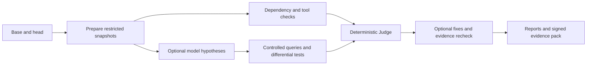

# Architecture

Proven separates change preparation, evidence gathering, adjudication and presentation. Models and databases are adapters selected by the operator.

## From change to result

| Stage | Inputs | Output and boundary |
| --- | --- | --- |
| Prepare | Target, available base commit, configured read bounds and policy | Bounded change description and isolated snapshots; no fetching missing Git objects. |
| Plan | Paths, classes, Scout result and conservative checks | Selected agents/tools/sources and doubling requirement. A lighter classification cannot erase security obligations. |
| Planner | Diff/source context and optional carried state | Candidate risks and explicit pending hypotheses; no finding is proved here. |
| Investigator | Candidate and allowed query catalogue | Template requests with validated parameters, observed rows and snapshot identity. |
| Prover | Candidate, bounded base/head excerpts and nearby tests | Generated test through the registered language adapter and observed differential outcome, or abstention/no-run. |
| Skeptic | Candidate with its collected evidence | Refutation attempt, with its own supporting evidence where available. |
| Judge | Candidate evidence and refutation | Deterministic keep/drop decision and proof level. No model call. |
| Fixer / autofix | Proved findings and observed evidence | Proposed edit plus validation results; copies only, no commit or merge. |
| Writer / formatters | Adjudicated findings, opinions, identities, service failures and coverage gaps | Common result rendered as text/JSON/SARIF/Markdown/HTML and optional pack. No model call. |

The model path uses Planner, Investigator, Prover and Skeptic stages. Models supply hypotheses, query-template parameters, generated tests or edits, never executable shell commands. [Walkthrough](WALKTHROUGH.md) follows both test and query evidence in one recorded review.

The evidence store runs registered templates over source tables. SQLite, PostgreSQL, CouchDB, legacy fixture files and Zetaris are interchangeable at this boundary. Dependency version matching happens in Go. The runner executes tests on base and head inside restricted containers, with no network or inherited secrets.

For live reviews the Prover receives the risk, a bounded source excerpt from both snapshots, and existing tests in the same package. Built-in advisory queries proposed by a model must bind to a dependency or advisory affected by the change before they contact a database. A missing source required by the deterministic dependency scan still makes analysis incomplete.

## Evidence and adjudication

Tests, controlled queries and deterministic tools are separate evidence kinds. A generated test must pass on base and fail on head under the runner's rules. A dependency query supplies rows and source identity; ecosystem code evaluates the affected interval. Tool adapters parse their observed outputs and preserve base/head differences.

The Skeptic's opinion alone cannot erase a test or tool proof. Query refutation must relate to the same row; independent proof is retained. Some text-based query interpretation remains heuristic. This boundary is implemented behavior, not a claim of formal completeness. [Output formats](OUTPUT_FORMATS.md) explains proof levels; [Design decisions](DESIGN.md) explains why evidence and model agreement stay separate.

Multiple reviewers retain their own roles and identities before results are combined. A two-model agreement without counting evidence belongs to a separate opinion section, not the proved-findings list. An unknown or shared model family remains visible rather than being relabelled as independence.

## Review planning and security floors

The default Scout mapping is:

| Kind | Work selected before conservative validation |
| --- | --- |
| Dependency | Planner, Investigator and Skeptic with dependency sources/tools; no generated-test Prover or Fixer. |
| Refactor / feature / config | Full configured plan. |
| Security | Full plan in security class, doubled. |
| Documentation | No models, tools or sources, only when every changed path passes the prose checks. |

Path rules provide a minimum class. A configured plan cannot lower that floor or remove required doubling. The dependency/documentation shortcuts are accepted only after checking every path; other changes classified into those lighter kinds run fully in security class. Prose must have an allowed suffix, no executable bit and no shebang on either side. Source/build/template suffixes cannot be configured as prose. `scout_intent: off` runs the full plan.

Plans and path rules are operator/repository policy, not arbitrary instructions taken from changed source text. See [Configuration](CONFIGURATION.md#provenyaml), [Policy](POLICY.md) and the [engine limits](READINESS.md).

## Code boundaries

- `internal/change`: bounded change reads and snapshot preparation.
- `internal/candidate` and `internal/agent/judge`: evidence records and deterministic adjudication.
- `internal/report`: result types, proof levels and offline outcome re-derivation, without reviewer configuration or runtime initialization.
- `internal/evidence`: signed pack writing and verification, depending on report types rather than the application.
- `internal/generator`, `internal/store`, `internal/testrun`: model, database and execution adapters.
- `internal/feeds`: bounded public-data acquisition and incremental HTTP caching, with injected snapshot import.
- `internal/datacheck`: registered source rules evaluated without a model; observations remain separate from proved code findings.
- `internal/delivery`: per-source declarations and mechanical description checks, with no I/O or model initialization.
- `internal/review`: configuration and application wiring.
- `internal/cli` and `action/`: command-line and forge delivery.

Small packages and their tests can be taken into another reviewer. Proven remains independently runnable. See [ADAPTERS.md](ADAPTERS.md).

The `internal/` packages are repository-private Go packages, not a promised external module API. Reuse currently means selecting code and tests, understanding the small dependency set and wiring them into the receiving application's own boundary. It does not require embedding Proven's CLI or connecting another application's core to this runtime.

## Adapter and trust boundaries

| Boundary | Accepted input | Explicitly outside it |
| --- | --- | --- |
| Model transport | Configured endpoint/CLI, bounded prompt, call policy | Hidden vendor selection, arbitrary shell from answers. |
| Query store | Registered template and validated scalar parameters | Model-written SQL, unrestricted relation access. |
| Runner | Prepared scratch checkout and controlled argv | Inherited service secrets, runtime network access or source writes. |
| Source adapter | Prepared tables with source identity | Implicit automatic feed subscription or invented freshness. |
| Feed connector | Explicit refresh request, scoped package versions, configured provider roots | Model-selected URLs, unbounded downloads or stale-cache success after an upstream failure. |
| Report core | Evidence/result values | Reading environment or initializing model/database clients. |
| Forge delivery | Result and explicit workflow permissions | Treating untrusted PR text as privileged workflow instructions. |

Source comments, issue text, model answers and imported descriptions are untrusted data. The optional model guardrail is an additional classifier, not the boundary that makes arbitrary commands safe. Runner isolation and query validation do not depend on enabling it.

`--refresh-data` runs acquisition before review and imports through SQLite or PostgreSQL. Registered source rules then produce observations as well as the existing OSV findings. The report distinguishes HTTP check time, upstream measurement date and missing coverage. A failed refresh leaves available evidence visible and makes completion incomplete. See [source refresh](SOURCE_REFRESH.md).

Declared-scope assessment sends one PR/commit/comment source per model request. It preserves source identities, exact metadata/code quotations and source-specific failures. Deterministic description checks need no model and make no claim about delivered semantics. See [declared scope](PR_DELIVERY.md).

## Optional local engines

Markovian bounds the Planner's context for large changes. Scout Intent chooses a review plan, subject to conservative path checks. H-MEM stores previous refutations, and World Model keeps persistent entities and relationships. Each has an off switch. Their effect on review quality has not been established by conformance tests.

Final awaiting claims are coverage gaps, separate from finding candidates. The pipeline preserves their descriptions and reviewer roles, continues evidence gathering for identified risks, and reports incomplete coverage. A mid-plan carried-state overflow still refuses to continue rather than dropping claims. See [bounded planning](MARKOVIAN.md).

Query refutation remains conservative: a denial must refer to the same row, and query text cannot override an independent observed test or tool proof. The remaining text-based query interpretation is a documented limitation; typed source-specific contradiction rules are future work.

A pack verifies recorded decisions under the implemented rules. It does not prove execution occurred, establish completeness or re-run the tests. See [EVIDENCE_PACK.md](EVIDENCE_PACK.md).

## Failure and completion

Coverage and findings are orthogonal. A failed required source, model truncation, remaining final hypothesis or deadline can leave an incomplete result with zero or several findings. `partial` identifies interrupted execution; a finished bounded run with open hypotheses can be incomplete without being partial.

Where a result can be assembled, the pipeline preserves available evidence and gaps before enforcement returns exit 3. A fatal safety/configuration refusal can stop earlier. Do not turn a missing result into an empty successful report. [Readiness](READINESS.md#reading-completion-correctly) defines exit codes and [Troubleshooting](TROUBLESHOOTING.md) covers failure paths.

## State and observability

The evidence store, local trace, persistent engines and result files have distinct roles. State paths must stay outside reviewed source. JSONL records local events; optional OTLP export watches the same run; packs preserve selected result material with integrity checks. None is a substitute for fresh source data or executed proof. See [Operations](OPERATIONS.md) and [Observability](OBSERVABILITY.md).
