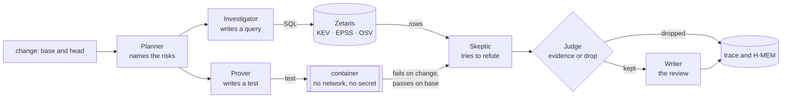

# Architecture

One page: the six agents, the order they run in, and what each one may and may not do. The reasons behind each choice
are in [DESIGN.md](../DESIGN.md) and in the decisions under [fleet/decisions/](../fleet/decisions/).

## The pipeline

## The six agents

| Agent | Does | Never |
|---|---|---|
| Planner | reads the change and names candidate risks | reports a risk on its own |
| Investigator | writes one SQL query per risk, run through Zetaris | treats a missing row as "not exploited" |
| Prover | writes the test that proves a risk; it runs once on the base and once on the change | runs code outside the container |
| Skeptic | tries to refute each finding, from another model family than the finder | decides: it only proposes |
| Judge | keeps a finding only on evidence: a test that fails on the change and passes on the base, or a query and its rows | settles by vote or confidence |
| Writer | writes the review from what the Judge kept | adds a finding |

The model-calling agents (Planner, Investigator, Prover, Skeptic) speak to Meterless Nightshift. Every prompt and every
answer passes the NVIDIA content-safety guardrail first.

A dependency the change adds or raises is not named by those agents. Proven reads `go.mod`, `package.json` and
`requirements.txt`, queries the OSV package table once per package, and compares the version in Go. The Judge still
decides: a matching range is evidence, and a version outside every range is a trace line, not a finding. See
[OSV_TABLE.md](OSV_TABLE.md).

## What is kept, and where

- **The trace** (`logs/trace.jsonl`): one JSON line per claim, evidence, refutation, verdict, guardrail check and model
  call, with the run id and the time. A reader follows any finding from claim to verdict.
- **H-MEM** (`state/hmem`): what earlier reviews refuted, so a refuted finding does not come back.
- **The World Model** (`state/world`, `logs/world.jsonl`): the entities a review has seen.

Both engines follow the Meterless specifications (ADR-0003, ADR-0018); their own conformance suites run through
`conformance/meterless/run.sh`.

## Modes

- **Sample** (`--sample`): recorded answers, outcomes and rows; no network. See [SAMPLE_MODE.md](SAMPLE_MODE.md).
- **Live**: Nightshift, Zetaris, the guardrail and a container runtime. A live review needs only a git repository. See [CONFIGURATION.md](CONFIGURATION.md); check
  readiness with `go run ./cmd/livecheck`. A service that is missing is named in the review's failed services.

## The seam

The shell (command line, output formats, GitHub Action) and the reviewer meet in one Go package, `internal/review`:
`review.Open(options)` returns a reviewer, and `Review(ctx, request)` returns the result. Neither side reaches into the
other.
