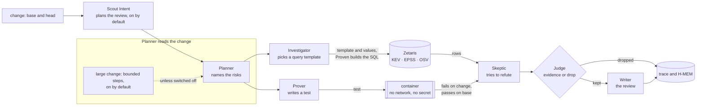

# Architecture

One page: the six agents, the order they run in, and what each one may and may not do. The reasons behind each choice
are in [DESIGN.md](../hackathon/DESIGN.md) and in the decisions under [fleet/decisions/](adr/).

## The pipeline

## The six agents

| Agent | Does | Never |
|---|---|---|
| Planner | reads the change and names candidate risks | reports a risk on its own |
| Investigator | picks one query template and its values per risk; Proven checks each value and builds the SQL ([QUERIES.md](QUERIES.md), [ADR-0032](adr/ADR-0032-proven-builds-every-query-from-a-template.md)), run through Zetaris | writes SQL; treats a missing row as "not exploited" |
| Prover | writes the test that proves a risk; it runs once on the base and once on the change | runs code outside the container |
| Skeptic | tries to refute each finding, from another model family than the finder | decides: it only proposes |
| Judge | keeps a finding only on evidence: a test that fails on the change and passes on the base, or a query and its rows | settles by vote or confidence |
| Writer | writes the review from what the Judge kept | adds a finding |

The model-calling agents (Planner, Investigator, Prover, Skeptic) speak to Meterless Nightshift, or, when
`PROVEN_GENERATOR_MODE=nvidia`, to NVIDIA's hosted API (ADR-0031). Every prompt and every
answer passes the NVIDIA content-safety guardrail first.

A dependency the change adds or raises is not named by those agents. Proven reads `go.mod`, `package.json`,
`requirements.txt`, `composer.json`, `Cargo.toml`, `build.gradle.kts` and `libs.versions.toml`, and the lock file in the same directory, queries the OSV package table once per package,
and compares the version with that language's adapter. The Judge still decides: a matching range is evidence, and a
version outside every range is a trace line, not a finding. See [OSV_TABLE.md](OSV_TABLE.md) and
[ADAPTERS.md](ADAPTERS.md).

## Proposed fixes (ADR-0042)

After the Judge, a **Fixer** step asks the model for a patch for each kept finding that a test proved, and proves the
patch with the same test. The patch is a list of edits, applied to a scratch copy of the change and never to the change
itself. The test-run adapter then runs, in the Prover's container, the proving test three times: on the base (it must
pass), on the change (it must fail) and on the change with the patch applied (it must pass), and then the other tests of
the package on the patched change (they must pass). Only a patch that passes all four is shown as a fix; `Fix.Runs`
records each run with its command and exit code, so a reader can run them again.

A patch that fails is tried again by the same model with the failed run in hand, up to `fix_attempts` times (default 2).
After the last attempt the review says "fix not proved" and shows no patch. A patch may not edit a test file: the fix is
proved by the test that showed the problem, so a patch that could rewrite it would prove nothing. The patch is a
suggestion for a person to apply. `fixes: off` in `proven.yaml` turns proposed fixes off.

### The one whole-change attempt (ADR-0050)

With `autofix: on`, a review makes one more step after every finding is final: the **autofix** step
(`internal/agent/autofix`). It takes every kept finding that a test, a query or a tool proved, and sends the generator one
prompt that holds all of them with their evidence, as escaped data. The generator answers with one patch: edits that name
a file, the exact old text and the new text, never a command. The patch passes the same checks as any patch (a path
outside the change, a test file, text that is not in the file once, and an answer that carries a command are each refused
by name) and is applied to copies of the change only. Proven then runs each finding's own evidence again, in the places
where the change's code may run, and no model is asked:

| proof | closed when |
|---|---|
| test | the test passes on the patched change and the package's other tests still pass |
| data | the dependency check, run again on the patched change, no longer returns the row |
| tool | the same tool, run again in the container on the patched change, no longer reports it |

A finding with several proofs closes only when each of them closes, and a run that could not happen (a store down, a tool
that timed out, no container) leaves the finding open. Nothing else may have broken either: when every finding closed,
Proven runs `go test` on the patched copy for every package a patched file belongs to (the whole module for a module
file), and `Result.Autofix.Breakage` records those runs; a failure, or a run that did not happen, is `rejected`. If every
proved finding closed and those runs passed, `Result.Autofix.Verdict` is
`fixed automatically, waiting for a person`; otherwise it is `rejected`, with each open finding and the evidence of its
re-run. There is no second attempt, so `fix_attempts` is not read and the per-finding suggestions above are not made while
the attempt is on. The patch is carried on the Result as edits and as a unified diff for a review comment to publish as
suggested changes; a rejected patch is kept for the record and is never shown as a fix. Nothing is committed to the
author's branch. `autofix`, `autofix_generator` and `autofix_timeout` in `proven.yaml` configure it
([CONFIGURATION.md](CONFIGURATION.md)).

A dependency finding gets the smallest fixed version that leaves every affected range of the advisory rows the query
returned, with the row that shows it. It is compared in Go, from the same `osv-by-package` rows, and no test proves it,
so it is never marked proved.

## What is kept, and where

- **The trace** (`<user cache>/proven/logs/trace.jsonl`, or the directory `PROVEN_LOG_DIR` names): one JSON line per claim, evidence, refutation, verdict, guardrail check and model
  call, with the run id and the time. A reader follows any finding from claim to verdict.
- **H-MEM** (`<user cache>/proven/state/hmem`, `<user cache>/proven/logs/hmem.jsonl`): what earlier reviews refuted, so a refuted finding does not come back.
- **The World Model** (`<user cache>/proven/state/world`, `<user cache>/proven/logs/world.jsonl`): the entities a review has seen.
- **Scout Intent** (`internal/scout`, ADR-0049): the plan chosen for a review, written as one `plan` line to the trace
  before any agent runs. On by default (ADR-0053), switched off with `scout_intent: off`; its eval harness is described below.
- **Markovian** (`internal/markov`, ON by default, switched off with `PROVEN_MARKOVIAN=off`): the state carried from one step to the next when a large change is
  reviewed in bounded steps. It is kept in memory for the length of one review, and each step's size is in the trace.
  See "Bounded steps" below.

H-MEM, the World Model and Markovian follow the Meterless specifications (ADR-0003, ADR-0018, ADR-0048); their own
conformance suites run through `test/conformance/meterless/run.sh`: H-MEM 13 of 13, World Model 8 of 8, Markovian 8 of
8 (runner pinned at upstream commit `1742dec5`). Scout Intent follows Meterless's specification too (ADR-0049), and
Meterless's eval harness, pinned at the same commit, runs through `test/conformance/meterless/run_scout.sh`. Markovian
and Scout Intent are on by default (ADR-0053) and each is switched off by its setting; their benefit is UNMEASURED until the corpus recordings exist.

## Scout Intent plans each review (ADR-0049)

**On by default (ADR-0053), switchable off with `scout_intent: off`.** Its benefit is UNMEASURED until the measurement
below is run on recorded reviews. **The Scout guard (ADR-0053):** Scout may lighten a review only for a change whose
every file is verified prose (documentation plan) or a manifest (dependency plan). A change it called documentation or
dependency that is not so verified runs every agent in class `security`, doubled, never in class `docs`.

**What it does.** Before any agent runs, `internal/scout` (Meterless's Scout Intent in Go) classifies the change from
its changed files: `change.dependency`, `change.refactor`, `change.feature`, `change.security`, `change.docs` or
`change.config`. The answer comes with the signals that led there (each file and the pattern it matched) and any
ambiguity. The kind picks the plan, inside the review classes of ADR-0014:

| kind | class | agents | tools | sources | doubled |
|---|---|---|---|---|---|
| `change.docs` | `docs` | none | none | none | as the class |
| `change.dependency` | configured | Planner, Investigator, Skeptic (no Prover, no Fixer) | govulncheck | OSV, EPSS | as the class |
| `change.security` | `security` | all | all | all | always |
| `change.refactor`, `change.feature`, `change.config` | configured | all | all | all | as the class |

Five rules decide which plan runs, and a reader can check each one in the trace:

1. **The floor.** A plan never goes below the class the configured path rules choose (`floorClass` in
   `internal/review/plan.go`). If the plan's class ranks lower, the configured class runs in full. ADR-0036's
   organisation policy is not in this build; when it lands, its minimum class is passed to the same function. The
   floor keeps its work as well as its rank: a security-floored change runs every agent, tool and source whatever plan
   the kind proposes, so a manifest the rules call security (`go.mod` is, by default) runs the Prover.
2. **Ambiguity.** A change that is not wholly one kind (documentation beside code, a manifest beside new code) is never
   planned as a confident class. It runs the class its rules choose, in full.
3. **Security is never outvoted.** One file with a security signal plans the whole change as security-sensitive.
   Every security pattern of the configured path rules is a Scout signal too.
4. **Only verified prose runs no model.** A name proves nothing: `docs/run.go` matches the documentation trigger by its
   directory, and a script or a template under `docs/` does too. The documentation plan is chosen only when every
   changed file (and the old path of a rename) has a suffix on the `prose_suffixes` list, carries no executable bit
   and starts with no shebang line, on either side of the change, so a script that loses its header is still
   reviewed (`notProse` in `internal/review/plan.go`; the modes come from `change.FactsBetween` and
   `change.TreeFacts`). The list cannot name a source, script, build or template suffix: the loader refuses one by
   name (`builtSuffixes`), and the plan does not believe one set in code either. A file whose facts cannot be read is not prose. Anything else runs the class its rules
   choose in full, and the plan line says which file failed and why.
5. **The trace.** Every review writes one `plan` line before any agent runs. It names the class, the confidence and
   band, the signals, the ambiguity and the plan, or says `no plan chosen (scout_intent is off)`. Each part a plan
   leaves out gets its own `… is not in the plan` line.

**To switch it off or change it** (a person's act, in the baseline's `proven.yaml`, because a change never chooses its own review):

1. Add `scout_intent: off` to run every review in full. It is on when the key is absent.
2. To change a kind's plan, set its key with all five fields, for example
   `plan_docs: class=docs, agents=none, tools=none, sources=none, doubled=class`. A wrong field stops Proven with
   exit 7 and names the field and the values allowed.
3. Review one documentation-only change and read its trace. The `plan` line names `class change.docs` and
   `agents none`. If it says `no plan chosen`, the switch is not on in the settings the review read.

**Checked by Meterless's harness.** `test/conformance/meterless/run_scout.sh` runs Meterless's own eval runner,
unchanged, against the Go engine on Meterless's regression set (`SCORECARD_scout-intent.txt`). It then runs a copy of
that runner on Proven's change registry and fourteen change fixtures (`SCORECARD_scout-intent-changes.txt`). Both
scorecards are committed as the runners print them.

remark: measured 2026-10-25 at Meterless commit 1742dec: on Meterless's set, every metric is 1.000 and clarification_rate is 0.188, but each scored prompt appears verbatim among the fixture registry's examples, so the score shows the engine reproduces its seeds, not that it generalises.
remark: in the change set `injection_precision` (1.000) and `override_frequency` (0) have no positive examples (their denominators are empty and the runner supplies those defaults), so they measure nothing there and are not evidence of injection or override quality.
remark: the change set fails the published clarification_rate ceiling (0.429 against 0.25) by its own design (six of fourteen fixtures are ambiguous); clarification_agreement (1.000) is the number that says whether the engine asked at the right time.

**The measurement (ADR-0049 point 5).** One review per scenario, with the plan and without it. The generator is
scripted, so the call counts are exact and the times are Proven's own overhead with an instant model, never a live
model's latency. `TestPlanMeasurement` in `internal/review/measure_test.go` prints the table, and it fails if a plan
loses a finding. Measured 2026-10-25:

| scenario | model calls without plan | model calls with plan | wall without | wall with | findings without | findings with | lost |
|---|---|---|---|---|---|---|---|
| documentation only (scripted) | 4 | 0 | 110ms | 82ms | 0 | 0 | 0 |
| dependency only, one OSV advisory, manifest not called security (scripted) | 4 | 3 | 1.113s | 792ms | 1 | 1 | 0 |
| dependency only, one OSV advisory, manifest called security, the default (scripted) | 8 | 8 | 844ms | 1.39s | 1 | 1 | 0 |
| security-sensitive session code (scripted) | 4 | 8 | 118ms | 192ms | 0 | 0 | 0 |
| feature: one modified Go file (scripted) | 4 | 4 | 131ms | 121ms | 0 | 0 | 0 |
| ambiguous: documentation beside code (scripted) | 4 | 4 | 130ms | 132ms | 0 | 0 | 0 |
| the corpus cases | UNMEASURED — no corpus recording (proven-test-corpus record-and-replay not yet landed) | | | | | | |

remark: a scripted planner names one risk and nothing proves it, so "findings 0 / lost 0" on four rows says only that no finding existed to lose; the dependency row is the one case where a finding existed and the plan kept it.
remark: the two dependency rows differ only in the path rules: where the rules call the manifest security (the default), the plan keeps the floor's full agent set and doubles the review, so it cuts nothing; the cut applies only where the rules leave the manifest in a lower class. Re-measured 2026-10-25 on a loaded machine, so the wall times of all rows are not comparable with the older ones.
remark: the security row costs more by design: the plan doubles a change the configured rules did not call sensitive.

## Bounded steps: Meterless's Markovian engine (ADR-0048)

`internal/markov` is Meterless's Markovian engine in Go, built to its specification (Meterless `engines/markovian`,
`AGENTS.md`, at commit `1742dec56a66e58eef9dda2d2b865823758ca8cd`): the chunk configuration and its bounds, the marker
protocol, the carryover cascade, the two mode prompts with the overlap window, the orchestrator loop and its reflection
pass, and the efficiency model. Meterless's own runner checks it through `run.sh`, beside H-MEM and the World Model; the
scorecard, `test/conformance/meterless/SCORECARD_markovian.txt`, is published as it is: 8 of 8 checks pass.

**What it does in Proven, and only when switched on.** Today only the Planner reads the change, and it reads all of it
in one prompt; the Investigator, the Prover and the Skeptic see a finding's id and title, and the Fixer one file. So the
engine stands in two places:

1. **The Planner.** A change whose whole Planner prompt is above the threshold is read one part per step. Each step's
   prompt holds one part and the carried state, never the rest of the change. The model answers with the risks this part
   shows and the state to carry on: what is established, what is suspected, and which claims await evidence from a part
   not yet read. A claim carried as awaiting evidence becomes a risk at the step that reads its evidence.
2. **The proved-fix loop (ADR-0042).** Each new attempt carries only what failed and why, within the same bound, and
   nothing an earlier attempt proposed.

At or below the threshold, or with the switch off, the review is exactly what it was. The trace says, per Planner run,
whether bounded steps ran and why not, and gives each step's part, prompt size and carried-state size.

**How the spec's unit maps onto Proven's.** The spec's step is a chunk of generation whose size the model decides, ended
by a `[STATE_CHECKPOINT]` marker. A review's steps are fixed in advance: one per file, or one per hunk. The mapping:

| spec | Proven's review |
|---|---|
| one chunk | one part: a file (its base and change) or a hunk (a changed region, three lines of context) |
| `[STATE_CHECKPOINT]` + state block | the step's JSON answer: `risks`, and `established`, `suspected`, `awaiting_evidence` |
| `COMPLETED` / `REMAINING` | parts read / parts left, counted by Proven, not written by the model |
| `DECISIONS` | what is established |
| `CONTEXT` | what is suspected, then what awaits evidence (the bound cuts it last, and never in silence: see below) |
| `carryoverTokens` | `PROVEN_MARKOVIAN_CARRY_TOKENS`, with the spec's bounds (128 to 32768) |
| `[TASK_COMPLETE]` | the last part read |
| cascade level 1 (the model's own state) | the step's answer, cut to the bound |
| cascade level 2 (a second model call to compress) | not used in the review: it would add a model call to every step |
| `maxChunks` (at most 32) | not applied to the review: its chain is closed, one step per part, so a 60-file change takes 60 steps |

The generic loop (`markov.Execute`, and the machine the conformance runner drives) keeps every rule of the spec,
`maxChunks` included. The history service, the engine tab and the telemetry panel of the spec are user-interface and
storage parts Proven does not have; they are not built.

**When the carried state is full (ADR-0048).** The bound first cuts what is established, oldest first, then what is
only suspected. A claim that awaits evidence is never cut and never dropped, however long it is: it is carried whole,
as a pinned line that the 400-byte limit on other items does not touch. A claim that is shortened can no longer name
the evidence it needs, and a claim lost can never meet its evidence, and the review would go on looking complete. If
the bound cannot hold every open claim whole, the review stops before anything is cut, with `*markov.CarryFullError`.
Its message says the bounded review is incomplete, after which step, how many of the open claims fit whole, and the
two ways on: run the whole review (`PROVEN_MARKOVIAN=off`) or raise
`PROVEN_MARKOVIAN_CARRY_TOKENS`. The trace carries the same sentence on a `bounded-steps` line. The review does not
fall back by itself: the caller decides. Tests: `TestAnOverflowingCarryStopsTheReviewByName` (the stop) and
`TestTheEarliestOpenClaimReachesItsEvidenceWhenTheBoundHoldsThem` (the same claim, with room, becomes a risk at its
evidence), `TestALongOpenClaimIsCarriedWholeToItsEvidence` (a claim over 400 bytes, its evidence named at the end,
reaches that evidence whole) and `TestALongOpenClaimThatCannotBeHeldWholeStopsTheReviewBeforeAnyCut` (when the bound
cannot hold it whole, the review stops by name at the step that raised it). A claim still open after the last step is not lost either: no part is left to supply its evidence, so the review stops
with `*markov.OpenClaimsError` (its message gives the number of steps and of open claims, never the claim text), and the
trace carries the same sentence. A bounded review that stops ends with that named error; Proven does not yet fall back to a whole review, so the caller sees an incomplete review, never a silent success. Test:
`TestAClaimStillOpenAfterTheLastStepStopsTheReviewByName` (two files, the last answer holds one open claim and no risk).
A model that leaves a claim out of the state it returns is a model error this bound cannot see.

**Settings** (environment, live and sample mode; see [CONFIGURATION.md](CONFIGURATION.md)): `PROVEN_MARKOVIAN` (`on` by
default, `off` switches it off), `PROVEN_MARKOVIAN_THRESHOLD` (estimated tokens of the Planner's whole prompt, default 8000),
`PROVEN_MARKOVIAN_STEP_UNIT` (`file` or `hunk`), `PROVEN_MARKOVIAN_CARRY_TOKENS` (default 800). A wrong value stops the
review before it starts, naming the variable and the values allowed.

**The measurement (ADR-0048 point 4).** Planner model tokens, prompt plus answer, estimated as characters / 4, from
`go test -count=1 -run TestBoundedStepsMeasurement -v ./internal/pipeline` on 2026-10-25. The sample scenarios run a
scripted generator, not a model: they measure the size of what Proven sends and receives, never a model's findings.

| scenario | whole: steps | whole: tokens per step | whole: tokens per review | bounded: steps | bounded: largest step | bounded: mean step | bounded: tokens per review | same findings |
|---|---|---|---|---|---|---|---|---|
| 24 files, file steps (scripted) | 1 | 36169 | 36169 | 24 | 1977 | 1899 | 45586 | yes |
| 24 files, hunk steps (scripted) | 1 | 36169 | 36169 | 26 | 577 | 509 | 13250 | yes |
| 60 files, file steps (scripted) | 1 | 90061 | 90061 | 60 | 1977 | 1876 | 112619 | yes |
| 3 files, below the threshold (scripted) | 1 | 4659 | 4659 | 1 | 4659 | 4659 | 4659 | yes |
| corpus PV-001 to PV-021 | UNMEASURED — no corpus recording (proven-test-corpus record-and-replay not yet landed) | | | | | | | |

What it shows: in these scripted scenarios, whose files are all about the same size, the step stays under 2,000 estimated
tokens however many files the change has, where the whole step grows with the change. This is not a general bound. The
carry bound caps the carried state only, never a part's own size: in file mode a whole file is one part, and in hunk mode
a large changed region is one hunk, so a step over a very large file or region is as large as that part. With file steps the review as a whole costs more,
about a quarter more, because every step repeats the instruction and the carried state; with hunk steps it costs less,
because a step carries the changed region and not both whole copies of the file. Whether a model keeps the same findings
across steps is not measured here: the scripted generator finds what it is scripted to find. That is the corpus row. It is not
measured, and since ADR-0053 the engine is on by default anyway (superseding ADR-0048 point 4); `PROVEN_MARKOVIAN=off` switches it off.

## Modes

- **Sample** (`--sample`): recorded answers, outcomes and rows; no network. See [SAMPLE_MODE.md](SAMPLE_MODE.md).
- **Live**: Nightshift, Zetaris, the guardrail and a container runtime. A live review needs only a git repository. See [CONFIGURATION.md](CONFIGURATION.md); check
  readiness with `go run ./cmd/livecheck`. A service that is missing is named in the review's failed services. A tracked symlink is left out of the trees; the trace names it and the result lists the path.

## The seam

The shell (command line, output formats, GitHub Action) and the reviewer meet in one Go package, `internal/review`:
`review.Open(options)` returns a reviewer, and `Review(ctx, request)` returns the result. Neither side reaches into the
other.

## Two reviewers (ADR-0037)

With `PROVEN_SECOND_REVIEWER_KEY`, `_BASE_URL` and `_MODEL` set, `generator.NewSecond` is the special-review generator: any
OpenAI-compatible chat API behind the same `Generator` interface, called through the guardrail like every model call.
`review.Open` refuses a wrong value before any review (exit 7); with no key nothing is connected and one reviewer reviews.
A connected second reviewer doubles every class unless `proven.yaml` names the classes, and always doubles `security`.
The two reviewers run independently: the second Planner and Skeptic are shown only the second reviewer's own words.

**For the shell train (the block *The reviewers disagree*):** the review result carries these fields, and the shell renders
only from them.

| Field | Meaning |
|---|---|
| `Result.Reviewers` | one `ReviewerInfo` per reviewer, the default first: `Role` (`default` or `special`), `Model`, `Family`, `IsAuthorModel` (`yes`, `no` or `unknown`) |
| `Finding.Verdicts` | empty when one reviewer ran, else one `ReviewerVerdict` per reviewer, the default first: `Role`, `Model`, `Verdict`, `Reason` |
| `Finding.Disagree` | true when the reviewers who answered gave different verdicts; render the block for these findings |
| `Result.Disagreements` | how many findings have `Disagree` set |

`Verdict` is one of `reported` (the reviewer named the risk), `not reported` (its own review did not name it), `refuted`
(it named the risk and its own Skeptic claimed to refute it) or `no answer` (its service failed; never a disagreement,
and the failure is in `FailedServices` under `second-reviewer`). `Reason` is the reviewer's own text: its message for the
risk, or its Skeptic's reason. The verdicts are shown side by side and never combined; evidence still decides which
findings exist. JSON and SARIF carry both verdicts, as the values above.

## Levels of proof (ADR-0044)

Each finding carries one named level of proof, `review.Finding.ProofLevel`. The reviewer core sets it from the finding's strongest evidence, and a finding whose evidence gives no level is refused before it reaches the result. From strongest to weakest:

| Level | JSON and SARIF value | Set today |
|---|---|---|
| proved by a test | `proved-by-test` | yes: a test fails on the change and passes on the base |
| proved by a tool | `proved-by-tool` | yes: a tool reports a result on the change and not on the base (ADR-0040) |
| proved by data | `proved-by-data` | yes: a query and its rows |
| agreed by two models, not proven | `agreed-by-two-models-not-proven` | the key stays in the totals at 0. ADR-0041 keeps the opinion in `Result.Opinions`, not in the findings, so it is not counted |

`review.Result.ProofCounts` counts the findings by level, with every level present as a key and 0 when none, so the counts add up to the findings. An agreed opinion is not a finding and is not in these counts (ADR-0041). `review.ProofLevels` lists the levels in this order.

**For the shell train (output formats):** render `Finding.ProofLevel` first in the text, Markdown, HTML and pull-request comment, as a field in JSON and SARIF, and render `Result.ProofCounts` as the totals by level. A proposed fix (ADR-0042) is not a level of proof. It is `Finding.Fix`, with `Proved`, the edits, the explanation and the runs; render it under the finding it belongs to, and render a fix that was not proved as "fix not proved" with `Fix.Note`, never as a patch. The text output does this today; the other formats carry the same fields when they are built.
