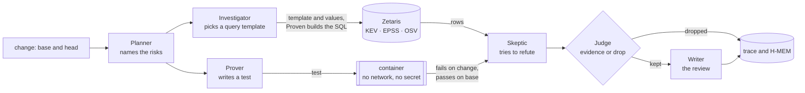

# Architecture

One page: the six agents, the order they run in, and what each one may and may not do. The reasons behind each choice
are in [DESIGN.md](../hackathon/DESIGN.md) and in the decisions under [fleet/decisions/](adr/).

## The pipeline

## The six agents

| Agent | Does | Never |
|---|---|---|
| Planner | reads the change and names candidate risks | reports a risk on its own |
| Investigator | picks one query template and its values per risk; Proven checks each value and builds the SQL ([QUERIES.md](QUERIES.md), [ADR-0032](adr/ADR-0032-proven-builds-every-query-from-a-template.md)), run through Zetaris | writes SQL; treats a missing row as "not exploited" |
| Prover | writes the test that proves a risk; it runs once on the base and once on the change | runs code outside the container |
| Skeptic | tries to refute each finding, from another model family than the finder | decides: it only proposes |
| Judge | keeps a finding only on evidence: a test that fails on the change and passes on the base, or a query and its rows | settles by vote or confidence |
| Writer | writes the review from what the Judge kept | adds a finding |

The model-calling agents (Planner, Investigator, Prover, Skeptic) speak to Meterless Nightshift, or, when
`PROVEN_GENERATOR_MODE=nvidia`, to NVIDIA's hosted API (ADR-0031). Every prompt and every
answer passes the NVIDIA content-safety guardrail first.

A dependency the change adds or raises is not named by those agents. Proven reads `go.mod`, `package.json`,
`requirements.txt` and `composer.json`, and the lock file beside each, queries the OSV package table once per package,
and compares the version with that language's adapter. The Judge still decides: a matching range is evidence, and a
version outside every range is a trace line, not a finding. See [OSV_TABLE.md](OSV_TABLE.md) and
[ADAPTERS.md](ADAPTERS.md).

## Proposed fixes (ADR-0042)

After the Judge, a **Fixer** step asks the model for a patch for each kept finding that a test proved, and proves the
patch with the same test. The patch is a list of edits, applied to a scratch copy of the change and never to the change
itself. The test-run adapter then runs, in the Prover's container, the proving test three times: on the base (it must
pass), on the change (it must fail) and on the change with the patch applied (it must pass), and then the other tests of
the package on the patched change (they must pass). Only a patch that passes all four is shown as a fix; `Fix.Runs`
records each run with its command and exit code, so a reader can run them again.

A patch that fails is tried again by the same model with the failed run in hand, up to `fix_attempts` times (default 2).
After the last attempt the review says "fix not proved" and shows no patch. A patch may not edit a test file: the fix is
proved by the test that showed the problem, so a patch that could rewrite it would prove nothing. The patch is a
suggestion for a person to apply. `fixes: off` in `proven.yaml` turns proposed fixes off.

A dependency finding gets the smallest fixed version that leaves every affected range of the advisory rows the query
returned, with the row that shows it. It is compared in Go, from the same `osv-by-package` rows, and no test proves it,
so it is never marked proved.

## What is kept, and where

- **The trace** (`logs/trace.jsonl`): one JSON line per claim, evidence, refutation, verdict, guardrail check and model
  call, with the run id and the time. A reader follows any finding from claim to verdict.
- **H-MEM** (`state/hmem`): what earlier reviews refuted, so a refuted finding does not come back.
- **The World Model** (`state/world`, `logs/world.jsonl`): the entities a review has seen.

Both engines follow the Meterless specifications (ADR-0003, ADR-0018); their own conformance suites run through
`test/conformance/meterless/run.sh`.

## Bounded steps: Meterless's Markovian engine (ADR-0048)

`internal/markov` is Meterless's Markovian engine in Go, built to its specification (Meterless `engines/markovian`,
`AGENTS.md`, at commit `1742dec56a66e58eef9dda2d2b865823758ca8cd`): the chunk configuration and its bounds, the marker
protocol, the carryover cascade, the two mode prompts with the overlap window, the orchestrator loop and its reflection
pass, and the efficiency model. Meterless's own runner checks it through `run.sh`, beside H-MEM and the World Model; the
scorecard, `test/conformance/meterless/SCORECARD_markovian.txt`, is published as it is: 8 of 8 checks pass.

**What it does in Proven, and only when switched on.** Today only the Planner reads the change, and it reads all of it
in one prompt; the Investigator, the Prover and the Skeptic see a finding's id and title, and the Fixer one file. So the
engine stands in two places:

1. **The Planner.** A change whose whole Planner prompt is above the threshold is read one part per step. Each step's
   prompt holds one part and the carried state, never the rest of the change. The model answers with the risks this part
   shows and the state to carry on: what is established, what is suspected, and which claims await evidence from a part
   not yet read. A claim carried as awaiting evidence becomes a risk at the step that reads its evidence.
2. **The proved-fix loop (ADR-0042).** Each new attempt carries only what failed and why, within the same bound, and
   nothing an earlier attempt proposed.

At or below the threshold, or with the switch off, the review is exactly what it was. The trace says, per Planner run,
whether bounded steps ran and why not, and gives each step's part, prompt size and carried-state size.

**How the spec's unit maps onto Proven's.** The spec's step is a chunk of generation whose size the model decides, ended
by a `[STATE_CHECKPOINT]` marker. A review's steps are fixed in advance: one per file, or one per hunk. The mapping:

| spec | Proven's review |
|---|---|
| one chunk | one part: a file (its base and change) or a hunk (a changed region, three lines of context) |
| `[STATE_CHECKPOINT]` + state block | the step's JSON answer: `risks`, and `established`, `suspected`, `awaiting_evidence` |
| `COMPLETED` / `REMAINING` | parts read / parts left, counted by Proven, not written by the model |
| `DECISIONS` | what is established |
| `CONTEXT` | what is suspected, then what awaits evidence (the bound cuts it last, and never in silence: see below) |
| `carryoverTokens` | `PROVEN_MARKOVIAN_CARRY_TOKENS`, with the spec's bounds (128 to 32768) |
| `[TASK_COMPLETE]` | the last part read |
| cascade level 1 (the model's own state) | the step's answer, cut to the bound |
| cascade level 2 (a second model call to compress) | not used in the review: it would add a model call to every step |
| `maxChunks` (at most 32) | not applied to the review: its chain is closed, one step per part, so a 60-file change takes 60 steps |

The generic loop (`markov.Execute`, and the machine the conformance runner drives) keeps every rule of the spec,
`maxChunks` included. The history service, the engine tab and the telemetry panel of the spec are user-interface and
storage parts Proven does not have; they are not built.

**When the carried state is full (ADR-0048).** The bound first cuts what is established, oldest first, then what is
only suspected. A claim that awaits evidence is cut last, and never: a claim lost from the state can never meet its
evidence in a later part, and the review would go on looking complete. If the bound cannot hold every open claim, the
review stops with `*markov.CarryFullError`. Its message says the bounded review is incomplete, after which step, how
many of the open claims fit, and the two ways on: run the whole review (`PROVEN_MARKOVIAN=off`) or raise
`PROVEN_MARKOVIAN_CARRY_TOKENS`. The trace carries the same sentence on a `bounded-steps` line. The review does not
fall back by itself: the caller decides. Tests: `TestAnOverflowingCarryStopsTheReviewByName` (the stop) and
`TestTheEarliestOpenClaimReachesItsEvidenceWhenTheBoundHoldsThem` (the same claim, with room, becomes a risk at its
evidence). A model that leaves a claim out of the state it returns is a model error this bound cannot see.

**Settings** (environment, live mode only; see [CONFIGURATION.md](CONFIGURATION.md)): `PROVEN_MARKOVIAN` (`off` by
default), `PROVEN_MARKOVIAN_THRESHOLD` (estimated tokens of the Planner's whole prompt, default 8000),
`PROVEN_MARKOVIAN_STEP_UNIT` (`file` or `hunk`), `PROVEN_MARKOVIAN_CARRY_TOKENS` (default 800). A wrong value stops the
review before it starts, naming the variable and the values allowed.

**The measurement (ADR-0048 point 4).** Planner model tokens, prompt plus answer, estimated as characters / 4, from
`go test -count=1 -run TestBoundedStepsMeasurement -v ./internal/pipeline` on 2026-10-25. The sample scenarios run a
scripted generator, not a model: they measure the size of what Proven sends and receives, never a model's findings.

| scenario | whole: steps | whole: tokens per step | whole: tokens per review | bounded: steps | bounded: largest step | bounded: mean step | bounded: tokens per review | same findings |
|---|---|---|---|---|---|---|---|---|
| 24 files, file steps (scripted) | 1 | 36169 | 36169 | 24 | 1977 | 1899 | 45586 | yes |
| 24 files, hunk steps (scripted) | 1 | 36169 | 36169 | 26 | 577 | 509 | 13250 | yes |
| 60 files, file steps (scripted) | 1 | 90061 | 90061 | 60 | 1977 | 1876 | 112619 | yes |
| 3 files, below the threshold (scripted) | 1 | 4659 | 4659 | 1 | 4659 | 4659 | 4659 | yes |
| corpus PV-001 to PV-021 | UNMEASURED — no corpus recording (proven-test-corpus record-and-replay not yet landed) | | | | | | | |

What it shows: the step stays flat (under 2,000 estimated tokens) however many files the change has, where the whole step
grows with the change and would at some size not fit a model at all. With file steps the review as a whole costs more,
about a quarter more, because every step repeats the instruction and the carried state; with hunk steps it costs less,
because a step carries the changed region and not both whole copies of the file. Whether a model keeps the same findings
across steps is not measured here: the scripted generator finds what it is scripted to find. That is the corpus row, and
until it is measured the engine stays off (ADR-0048 point 4).

## Modes

- **Sample** (`--sample`): recorded answers, outcomes and rows; no network. See [SAMPLE_MODE.md](SAMPLE_MODE.md).
- **Live**: Nightshift, Zetaris, the guardrail and a container runtime. A live review needs only a git repository. See [CONFIGURATION.md](CONFIGURATION.md); check
  readiness with `go run ./cmd/livecheck`. A service that is missing is named in the review's failed services. A tracked symlink is left out of the trees; the trace names it and the result lists the path.

## The seam

The shell (command line, output formats, GitHub Action) and the reviewer meet in one Go package, `internal/review`:
`review.Open(options)` returns a reviewer, and `Review(ctx, request)` returns the result. Neither side reaches into the
other.

## Two reviewers (ADR-0037)

With `PROVEN_SECOND_REVIEWER_KEY`, `_BASE_URL` and `_MODEL` set, `generator.NewSecond` is the special-review generator: any
OpenAI-compatible chat API behind the same `Generator` interface, called through the guardrail like every model call.
`review.Open` refuses a wrong value before any review (exit 7); with no key nothing is connected and one reviewer reviews.
A connected second reviewer doubles every class unless `proven.yaml` names the classes, and always doubles `security`.
The two reviewers run independently: the second Planner and Skeptic are shown only the second reviewer's own words.

**For the shell train (the block *The reviewers disagree*):** the review result carries these fields, and the shell renders
only from them.

| Field | Meaning |
|---|---|
| `Result.Reviewers` | one `ReviewerInfo` per reviewer, the default first: `Role` (`default` or `special`), `Model`, `Family`, `IsAuthorModel` (`yes`, `no` or `unknown`) |
| `Finding.Verdicts` | empty when one reviewer ran, else one `ReviewerVerdict` per reviewer, the default first: `Role`, `Model`, `Verdict`, `Reason` |
| `Finding.Disagree` | true when the reviewers who answered gave different verdicts; render the block for these findings |
| `Result.Disagreements` | how many findings have `Disagree` set |

`Verdict` is one of `reported` (the reviewer named the risk), `not reported` (its own review did not name it), `refuted`
(it named the risk and its own Skeptic claimed to refute it) or `no answer` (its service failed; never a disagreement,
and the failure is in `FailedServices` under `second-reviewer`). `Reason` is the reviewer's own text: its message for the
risk, or its Skeptic's reason. The verdicts are shown side by side and never combined; evidence still decides which
findings exist. JSON and SARIF carry both verdicts, as the values above.

## Levels of proof (ADR-0044)

Each finding carries one named level of proof, `review.Finding.ProofLevel`. The reviewer core sets it from the finding's strongest evidence, and a finding whose evidence gives no level is refused before it reaches the result. From strongest to weakest:

| Level | JSON and SARIF value | Set today |
|---|---|---|
| proved by a test | `proved-by-test` | yes: a test fails on the change and passes on the base |
| proved by a tool | `proved-by-tool` | yes: a tool reports a result on the change and not on the base (ADR-0040) |
| proved by data | `proved-by-data` | yes: a query and its rows |
| agreed by two models, not proven | `agreed-by-two-models-not-proven` | the key stays in the totals at 0. ADR-0041 keeps the opinion in `Result.Opinions`, not in the findings, so it is not counted |

`review.Result.ProofCounts` counts the findings by level, with every level present as a key and 0 when none, so the counts add up to the findings. An agreed opinion is not a finding and is not in these counts (ADR-0041). `review.ProofLevels` lists the levels in this order.

**For the shell train (output formats):** render `Finding.ProofLevel` first in the text, Markdown, HTML and pull-request comment, as a field in JSON and SARIF, and render `Result.ProofCounts` as the totals by level. A proposed fix (ADR-0042) is not a level of proof. It is `Finding.Fix`, with `Proved`, the edits, the explanation and the runs; render it under the finding it belongs to, and render a fix that was not proved as "fix not proved" with `Fix.Note`, never as a patch. The text output does this today; the other formats carry the same fields when they are built.
