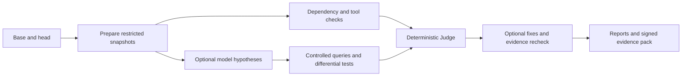

# Architecture

Proven separates change preparation, evidence gathering, adjudication and presentation. Models and databases are adapters selected by the operator.

The model path uses Planner, Investigator, Prover and Skeptic stages. The Judge and Writer operate without a model. Optional Fixer and whole-change autofix stages validate their proposed edits before presenting them. Models supply hypotheses, query-template parameters, generated tests or edits, never executable shell commands.

The evidence store runs registered templates over source tables. SQLite, PostgreSQL, CouchDB, legacy fixture files and Zetaris are interchangeable at this boundary. Dependency version matching happens in Go. The runner executes tests on base and head inside restricted containers, with no network or inherited secrets.

For live reviews the Prover receives the risk, a bounded source excerpt from both snapshots, and existing tests in the same package. Built-in advisory queries proposed by a model must bind to a dependency or advisory affected by the change before they contact a database. A missing source required by the deterministic dependency scan still makes analysis incomplete.

## Code boundaries

- `internal/change`: bounded change reads and snapshot preparation.
- `internal/candidate` and `internal/agent/judge`: evidence records and deterministic adjudication.
- `internal/report`: result types, proof levels and offline outcome re-derivation, without reviewer configuration or runtime initialization.
- `internal/evidence`: signed pack writing and verification, depending on report types rather than the application.
- `internal/generator`, `internal/store`, `internal/testrun`: model, database and execution adapters.
- `internal/review`: configuration and application wiring.
- `internal/cli` and `action/`: command-line and forge delivery.

Small packages and their tests can be taken into another reviewer. Proven remains independently runnable. See [ADAPTERS.md](ADAPTERS.md).

## Optional local engines

Markovian bounds the Planner's context for large changes. Scout Intent chooses a review plan, subject to conservative path checks. H-MEM stores previous refutations, and World Model keeps persistent entities and relationships. Each has an off switch. Their effect on review quality has not been established by conformance tests.

Query refutation remains conservative: a denial must refer to the same row, and query text cannot override an independent observed test or tool proof. The remaining text-based query interpretation is a documented limitation; typed source-specific contradiction rules are future work.

A pack verifies recorded decisions under the implemented rules. It does not prove execution occurred, establish completeness or re-run the tests. See [EVIDENCE_PACK.md](EVIDENCE_PACK.md).
