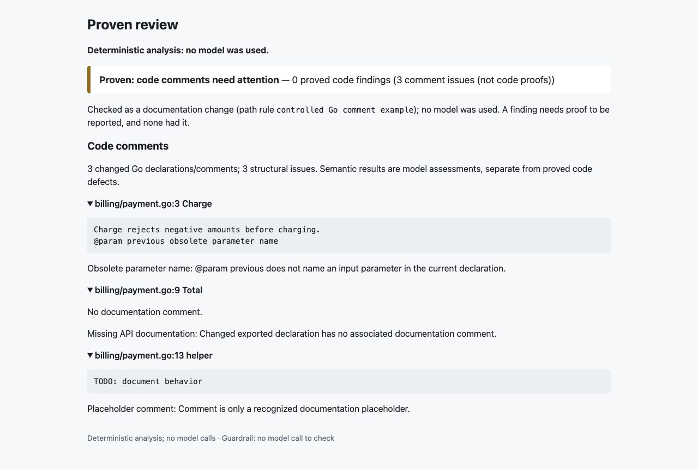
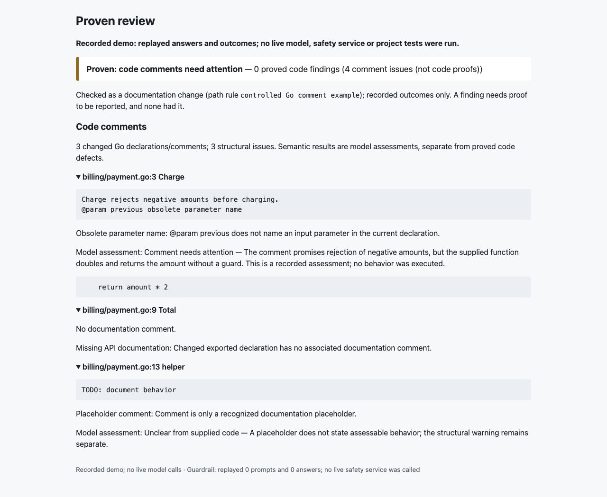

# Code comments: structure without a model, meaning with one

Proven checks **comments in code**, separately from [PR/commit declarations](PR_DELIVERY.md). The initial language adapter uses Go's parser and AST. A missing or stale comment is a documentation issue, not an automatically proved runtime defect.

## What runs today

| Without a model | Optional model assessment |
| --- | --- |
| Associate documentation with changed exported functions, methods, types, constants and variables. | Assess whether an existing comment is clear and consistent with its associated head code. |
| Flag changed exported declarations with no associated documentation. | Identify misleading wording, stale claims or grammar that changes the stated meaning. |
| Detect recognized placeholder comments. | Preserve the comment's language; no blanket demand for English. |
| Check the convention that documentation starts with the exported name. | Return `consistent`, `needs_attention` or `unclear`, with a checked code quotation when making a substantive assessment. |
| Flag an explicit `@param` tag whose name is absent from the current function's input parameters. | Keep each original comment separate; one failed answer does not discard the other results. |

The structural checker does not infer a requirement for `@param` tags or grade prose. A parameter can be well documented without such tags. The model's interpretation remains an assessment; quotation validation is deterministic, but a quoted line alone is not executable proof.

## Enable and configure



*Actual structural checks on synthetic Go source; no model calls.*



*The same source with recorded model answers and real citation validation. No live model or application tests ran. Reproduce both reports with the [comment example](../examples/comments/README.md).*

Deterministic checks are enabled for live reviews by default, including `PROVEN_GENERATOR_MODE=off`. They need no extra runtime, model account, database table or network connection.

For linguistic and code-consistency assessment, configure your model and set:

```sh
PROVEN_CODE_COMMENTS=model proven scan --baseline-commit HEAD~1 .
```

The same environment variable works in either GitHub Action:

```yaml
env:
  PROVEN_CODE_COMMENTS: model
```

| Value | Behavior |
| --- | --- |
| `deterministic` (default) | Structural checks only, even when another part of review uses a model. |
| `model` | Structural checks plus model assessment of comments. Requires a connected model and uses its configured call/time/token limits and optional guardrail. |
| `off` | Skip code comment checks. |

The generator role is `comments`. You can set its token limit through `PROVEN_GENERATOR_AGENT_MAX_TOKENS` (for example `{"comments":2048}`) and provider-specific request fields through `PROVEN_GENERATOR_AGENT_EXTRA_BODY`, independently of other review roles.

Semantic comment review is explicit because it adds requests and account usage. Recorded sample mode does not call this live stage.

## Scope, limits and failures

The adapter compares base/head declaration and comment associations in selected files. Unchanged legacy declarations remain outside the change review; a changed body brings its attached comment back into scope. Removing an existing public API comment is checked. Comments inside a changed file can also be inspected with a small surrounding excerpt.

The current Go adapter excludes `_test.go` and Go-generated files. It checks top-level exported declarations, not struct fields, interface members or a whole repository's API coverage. Comment-language adapters are independent of dependency readers and generated-test runtimes. **Other languages are currently listed as unsupported paths for this stage.** Unsupported coverage is not reported as a passed language check.

Bounds: 256 changed units, 8 KiB per comment, 32 KiB per declaration excerpt and 32 semantic units per review. Syntax errors, exceeded bounds, cancellation and unusable model answers leave incomplete comment coverage visible. Existing proved findings remain available. Required-completion CI can fail on this incomplete result; missing documentation itself does not become a proved code finding.

Text, Markdown and HTML show a separate **Code comments** section. JSON uses `code_comments`; SARIF carries the same object in run properties, outside vulnerability results. Each unit keeps its source, symbol, line, original text and associated code. Markdown announces omitted preview entries; JSON/HTML retain collected results.

## Why both checks matter

Section 5.3 of the [original Proven effort report](https://saphan.ai/assets/research/proven-effort.pdf?v=20261031) measured documentation presence for exported Go identifiers. That historical measurement describes the original snapshot. Presence and density do not establish that a description remains accurate; this feature keeps structural observations and semantic assessments separate instead of treating a percentage as a quality verdict.

## Add another language

Implement `codecomments.Adapter`: `Name`, `Matches` and `Extract`. Return stable declaration/comment identities, public-API markers, parameter names where parsed and exact head excerpts. Register it in `Adapters()` and add base/head fixtures for deleted docs, unchanged legacy code, malformed syntax and unsupported constructs. Do not execute target source to extract its comments.

The shared deterministic rules, optional model assessment, citation checks, redaction and reports then apply through the same core. Extend the language coverage table and README in the same change. See [adapter guide](ADAPTERS.md).
