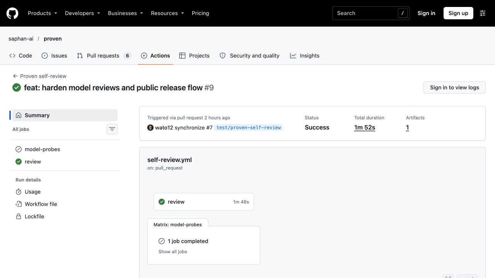
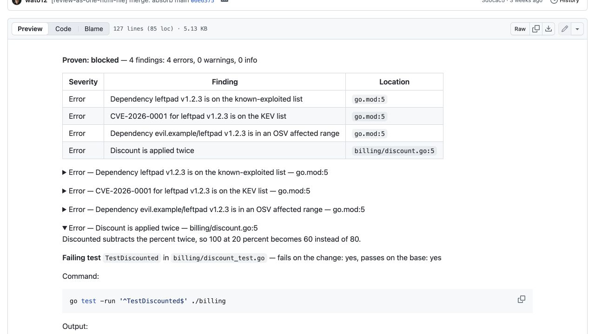
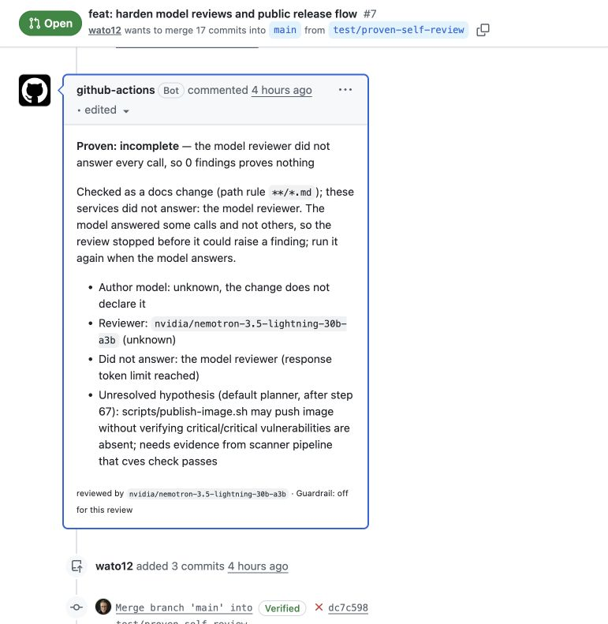

# What Proven looks like on GitHub

These are screenshots of GitHub, captured on 16 November 2026. They show an actual successful workflow, an actual incomplete-review comment and a rendered recorded finding example. The three views have different sources; the recorded example is not presented as a live detection result.

## A completed Actions run

[Open the recorded successful run](https://github.com/saphan-ai/proven/actions/runs/43817450372). The `review` job ran, retained an artifact and completed successfully. Optional compatibility probes were skipped. This earlier run used whole-change planning; the screenshot does not establish current bounded-mode quality. [Readiness](READINESS.md#what-has-been-measured) keeps its measured limits.

In your own run, open **Actions → Proven review → review** to inspect the steps. Look for the review result and retained evidence even when the gate is red. This repository retains JSON, SARIF and the redacted trace. Downloading artifacts or viewing logs may require signing in.

## A finding, with expandable evidence

This is GitHub's preview of the [recorded comment fixture](../testdata/golden/pr-comment/findings.md), using the same Markdown body that the report writer produces. It is not a posted live review. The dependency data is synthetic and test outcomes are recorded.

The table lets you scan severity, title and location. Expand a finding to see why it was kept: the discount example names its test and shows pass on base / fail on head, plus the controlled command. A real PR comment uses this report structure. Follow [the walkthrough](WALKTHROUGH.md) to generate the recording locally, or [the Action guide](ACTION.md) to enable comments for your own PRs.

## An incomplete review remains visible

The screenshot captures [PR #7's summary comment](https://github.com/saphan-ai/proven/pull/7#issuecomment-6906838359) after [this bounded run](https://github.com/saphan-ai/proven/actions/runs/43826723846). That comment is updated by later runs; the image preserves this particular state.

It names a token-limit failure and a final pending planning claim. Zero findings does not make that run complete. The claim is an unverified concern, not a published vulnerability. Required completion failed with exit 3 after preserving the result. [Troubleshooting](TROUBLESHOOTING.md) explains these outcomes.

## Connect it to your repository

1. Choose [your API credentials](CONNECT_API.md), [Claude Code/Copilot](CLI_MODELS.md), or [two reviewers](TWO_MODELS.md).
2. Prepare source data and the restricted runner required by your checks.
3. Add the [GitHub Action](ACTION.md), pin its revision and enable `comment` deliberately.
4. Open a small PR with a known expected outcome. Inspect the comment, completion, proof and artifacts together.

Customer-built [CLI images](CLI_IMAGES.md) stay under the customer's control; the official Proven image does not contain vendor CLIs or user credentials.
