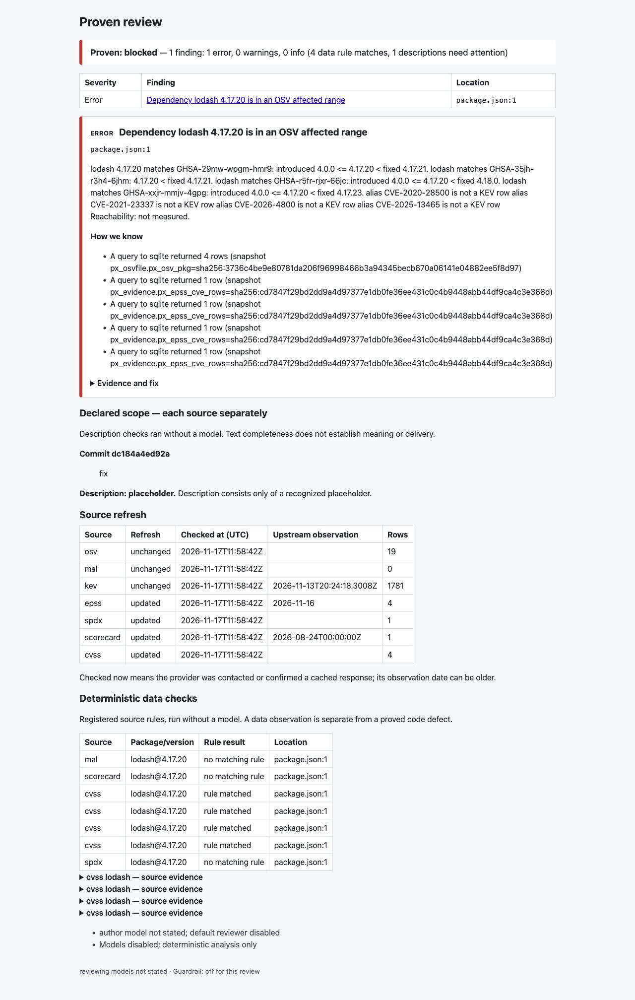

# Start without a model

The generic Proven image works without a model account, model API key or vendor CLI. It runs the deterministic parts of the review. Connecting a model adds hypothesis generation, proposed regression tests, suggested fixes and semantic assessment of declared scope.



*Measured 17 November 2026 on a controlled local Git change adding the public npm package `lodash 4.17.20`. Source acquisition and checks ran live; no model or application tests were executed. The report keeps source dates, data observations and the placeholder commit warning visible. [Retained measurement summary](audits/2026-11-17/model-free-refresh.json).*

## Review your last commit

For a built-in integration example first:

```sh
docker run --rm --network none --entrypoint /bin/sh saphan/proven:latest /opt/proven/model-free-smoke.sh
```

This creates real temporary Git history, imports synthetic teaching data into SQLite and runs dependency/data and commit-description checks. It expects a synthetic finding and confirms no model calls. It is an integration check, not a scan of your application or a measurement of a public feed.

From a checkout with at least two commits:

```sh
docker run --rm \
  --mount "type=bind,src=$PWD,dst=/repo,readonly" \
  --mount type=volume,src=proven-data,dst=/work/.cache \
  -e PROVEN_GENERATOR_MODE=off \
  saphan/proven:latest scan --refresh-data --baseline-commit HEAD~1 /repo
```

`HEAD~1` selects the last commit; use your actual base for a PR. The generic image contains Proven, Git and the Docker client. It does not contain licensed vendor CLIs, account sessions or every project's test dependencies. The cache volume keeps public source records and the SQLite evidence database outside the checkout. The conventional `/repo` mount is trusted for Git ownership checks inside this image; it stays read-only.

Refresh sends dependency coordinates to public providers, not source code. No model request is made. A refresh requires network access; imported data can subsequently be used offline. [Source refresh](SOURCE_REFRESH.md) explains the delta and provenance rules.

## What runs without a model

| Check | What it reports | Preparation |
| --- | --- | --- |
| OSV dependency comparison | Added/upgraded package versions inside advisory ranges. | `--refresh-data` or an imported snapshot. |
| CISA KEV and EPSS | Known-exploitation context and dated exploitation-probability scores. | Relevant source data. |
| Other registered data rules | Malicious-package, maintenance/signing, CVSS and licence observations. | Relevant rows; missing measurements stay explicit. |
| Commit descriptions | A separate mechanical check for every commit message in the range. | A Git base and head. |
| PR and comment descriptions | Separate checks for the PR description and each collected comment. | The GitHub Action's `check-delivery: true`, or an external context JSON. |
| Go code comments | Missing public API docs, placeholders, naming conventions and stale parameter tags on changed declarations. | No model or Go toolchain; the AST adapter is in the image. See [comment checks](CODE_COMMENTS.md). |
| Deterministic tools | For example, controlled Go race outcomes and configured govulncheck reachability. | Docker access, a prepared execution image and, for govulncheck, its offline database. |
| Policies and reports | Existing policy/evidence rules; text, JSON, SARIF, Markdown, HTML and packs. | Configuration only where your policy needs it. |

Data observations are not automatically code-defect findings. Package presence does not establish exploit reachability. Licence rules use the existing fixed permissive set; they do not implement a complete legal-compliance policy. Description checks do not judge meaning. [The evidence table](WHAT_PROVEN_CHECKS.md) records these distinctions.

The image includes the deterministic review code. Executing application tests still requires that application's runtime/dependencies and the [restricted runner](RUNNER.md). It cannot manufacture offline dependencies for an arbitrary repository. Model-free mode generates no new tests and does not perform semantic delivery assessment.

## Add it to GitHub Actions

Save `.github/workflows/proven.yml` in the repository you want reviewed:

```yaml
name: Proven without a model
on: [pull_request]
permissions:
  contents: read
  pull-requests: write
jobs:
  review:
    runs-on: ubuntu-latest
    timeout-minutes: 10
    steps:
      - uses: actions/checkout@3d3c42e5aac5ba805825da76410c181273ba90b1
        with:
          ref: ${{ github.event.pull_request.head.sha }}
          fetch-depth: 0
          persist-credentials: false
      - uses: saphan-ai/proven@main
        env:
          PROVEN_GENERATOR_MODE: 'off'
        with:
          refresh-data: true
          check-delivery: true
          comment: true
```

The job's GitHub token reads comments and posts the report. It is not a model credential and is removed before review and execution. Comment collection uses read-only requests; a collection failure is visible and does not erase available declarations. The example introduces no model secret. Pin a reviewed full Proven SHA for retained deployments. Fork permissions can prevent comment collection/posting; do not expose credentials to untrusted code to work around those restrictions.

Use a dedicated [prepared runner](RUNNER.md) when enabling execution tools. This short workflow focuses on dependency/data and description checks. JSON and SARIF paths are Action outputs; add an artifact-upload step if you want GitHub to retain them.

## Read the result

- A proved dependency finding retains its source query, affected range and snapshot.
- A data-rule match is a separately labelled observation. Read its rule, rows and source identity.
- Missing, placeholder or short descriptions remain separate per source.
- Missing data, failed refreshes and unexecuted required checks make the report incomplete; they do not become a clean measurement.

`--refresh-data` requires completion by default. CI also requires completion by default. The existing `PROVEN_REQUIRE_COMPLETE` switch remains an explicit operator override. Code findings and completion are separate: `--error` decides whether proved findings fail the scan; exit 3 indicates incomplete required work.

For an HTML report from a locally built binary:

```sh
PROVEN_GENERATOR_MODE=off proven scan --refresh-data \
  --baseline-commit HEAD~1 --html-output /tmp/proven-review.html .
```

A scan without a baseline needs prepared `base/` and `change/` trees. It does not silently guess which change you meant.

## Work offline

Refresh/import on a connected machine first. Then omit `--refresh-data` and set `PROVEN_NETWORK=local` with your allowed internal addresses. Retained data keeps its identity; the report must not describe it as newly fetched. Redirected public requests and background package installs do not become an offline fallback. See [local operation](AIR_GAPPED.md).

Next: [connect your CLI](START.md), [connect an API](CONNECT_API.md), [declared scope](PR_DELIVERY.md), or [add an adapter](ADAPTERS.md).
