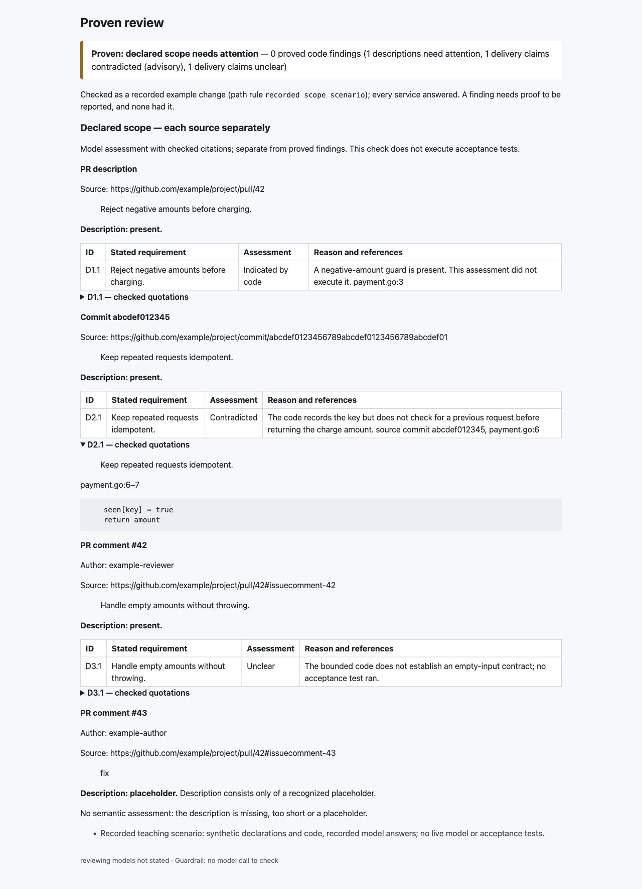

# Does the change deliver what people declared?

Proven treats the PR description, commit messages and comments as **separate sources of scope**. With a model, each source is compared with selected head code in its own request. Without a model, each source still receives a mechanical description-completeness check.

This is a second view of the change: ordinary findings show proved defects; declared-scope findings show what appears implemented, contradicted or unsettled. The two are labelled separately.



*Actual HTML writer output from the [recorded teaching example](../examples/scope/README.md): synthetic repository/code/comments and recorded model answers, with no live model or acceptance test. Each original source remains separate; expanding a finding shows checked quotations.*

## One source, one set of results

| Source | Separate identity |
| --- | --- |
| PR title | The PR URL and title source. |
| PR description | The PR URL and description source, including an empty description. |
| Each commit message | Its actual Git SHA and message. |
| Each PR discussion comment | GitHub comment ID, author and permalink. |
| Each submitted review body | Review ID, author and permalink; a bodyless approval declares no textual scope. |
| Each inline review comment/reply | Its individual comment ID and permalink, including separate replies. |
| Each comment on a commit in the reviewed range | Comment ID, commit SHA and permalink. |

The collector paginates these feeds. Proven's own summary comment is excluded when its marker and posting account match, so the next run does not assess its previous report. Copying that marker into somebody else's comment does not hide the comment.

No model request contains the other declaration sources. A model cannot quietly merge duplicate claims from two commits or decide that a later comment supersedes an earlier request. Each returned claim must cite its own supplied source. Proven assigns its ID and source linkage deterministically.

For example, “Reject negative amounts” in a PR body and the same sentence in a commit are two assessments. A later comment asking to allow negative amounts is a third. These may need human reconciliation; they remain three visible sources rather than becoming one global delivery verdict.

## Turn it on

For the generic Action, with no model:

```yaml
- uses: saphan-ai/proven@main
  env:
    PROVEN_GENERATOR_MODE: 'off'
  with:
    refresh-data: true
    check-delivery: true
    comment: true
```

For a connected CLI:

```yaml
- uses: saphan-ai/proven/cli@main
  with:
    backend: claude
    image: proven-claude:local
    check-delivery: true
    refresh-data: true
```

Use the complete [model-free workflow](MODEL_FREE.md#add-it-to-github-actions) or [CLI setup](START.md), including exact PR-head checkout and the base commit. Comment collection needs the appropriate GitHub read permissions; posting requires `pull-requests: write`. The job token is not a model credential. The collector uses only GET requests and never runs text from a PR as configuration or a command.

## Useful even without a model

| Description result | Mechanical rule |
| --- | --- |
| `missing` | No text remains beyond template headings, unchecked boxes and HTML comments. |
| `placeholder` | The whole remaining text is a recognized placeholder such as `fix`, `TODO`, `TBD` or `WIP`. |
| `too_short` | Fewer than three words or twelve letters remain after removing web links and issue references. |
| `present` | That word/letter rule passed. Meaning and implementation were not judged. |

Counts use Unicode letters. “Fix” fails; a normal sentence can pass; gibberish can pass too. This is intentionally a completeness rule, not a model-free claim to understand natural language. Missing descriptions are shown per source, without erasing code findings or merging them into an aggregate score.

A standalone model-free Git scan checks commit messages automatically when a base is supplied. It does not invent a missing PR description for a local Git context. GitHub context adds the actual PR/comment sources.

## With a model: read each source's findings

| Assessment | What it means | Attached information |
| --- | --- | --- |
| **Indicated by code** | The model found code that appears to implement the declaration. | Exact original quote, validated head-code lines, source ID and claim ID. |
| **Contradicted** | The model found code that appears inconsistent with it. | Checked citations; an existing proved finding can also be linked as a counterexample. |
| **Unclear** | Supplied context cannot settle the claim. | Reason and any available citations. |
| **No assessable claims** | The assessment extracted no concrete scope from that source. | The source remains visible. This does not certify delivery. |
| **Incomplete** | That source could not be assessed, or the deadline/query budget ended. | A source-specific reason; other results are retained. |

Requests and reviewer suggestions are assessed as requested changes, not rewritten into promises by the PR author. The comparison is against the current selected head. It does not reconstruct the code as it existed at the moment each comment was posted, infer thread-resolution intent or execute acceptance tests.

Claim IDs such as `D2.1` are local to the recorded review. Stable source information (SHA, comment ID and permalink) identifies the declaration. The report also records the reviewed snapshot and a metadata SHA-256, so later comment edits do not silently become the wording used for an earlier assessment.

## Reports and compatibility

The PR receives one updated Proven summary, with a separate section for each source. JSON and standalone HTML retain all collected source assessments. A platform-sized Markdown comment announces omitted source sections/findings and directs readers to the full artifacts.

JSON retains the existing `delivery.claims` array for consumers, with distinct IDs/source IDs and **no cross-source deduplication**. The additive `delivery.assessments` array holds each source, description check, semantic status, claims and any issue. SARIF keeps this under run properties, outside vulnerability results. Signed packs retain it as report data; offline verification does not independently reassess the meaning of a declaration.

Contradictions and uncertainty do not become test-proved defects or change proof counts. Description warnings are separate metadata observations. Failed requested semantic assessments or incomplete collection affect the existing completion policy; established code findings are preserved.

## Collection, privacy and limits

The Action reads the PR event, actual local Git messages and GitHub discussion/review/inline/commit-comment feeds. It writes context outside the reviewed checkout. Tokens are removed before model and project execution; they are never included in metadata or model prompts.

Collection has a 60-second deadline, 10 pages per feed and a 64 KiB total context limit. Permission failures, repeated pages, oversized data and interrupted feeds are named as incomplete collection. They are not converted to “no comments”. The collector does not follow API redirects with credentials. Its direct GitHub collection is unavailable under local-only network policy; supply an acquired external context file there.

Code context remains bounded to 32 selected files, 8 KiB per file and 128 KiB total. Up to 24 claims may be returned per source; at most 64 sources receive semantic model assessment in one review. Additional collected sources stay in the report with a not-assessed reason. Mechanical description checks do not require those model calls. Every source uses the configured generator limits, guardrail, recovery policy and shared review deadline.

More comments can mean more model requests and more time/quota. A failed source assessment does not consume the result of a successful neighboring one. If context is truncated, out-of-context claims may remain unclear. Exact citation validation establishes quoted-text presence, not the correctness of a model's interpretation.

## Supply context outside Actions

```json
{
  "context": "pull_request",
  "url": "https://github.com/example/project/pull/42",
  "title": "Reject negative amounts",
  "description": "Reject negative amounts before charging.",
  "commits": [{"sha": "<actual commit SHA>", "message": "Reject negative amounts before charging"}],
  "comments": [{"kind": "pr_comment", "id": 123, "body": "Handle empty amounts without throwing.", "author": "example", "url": "https://github.com/example/project/pull/42#issuecomment-123"}]
}
```

Point `PROVEN_PR_CONTEXT` at this external JSON file. Supported comment kinds are `pr_comment`, `review`, `review_comment` and `commit_comment`; IDs must be positive and unique within their kind. Previous title/description/commits-only files remain valid.

`action/delivery.py` is the standalone read-only GitHub collector. On a trusted runner with event/repository environment variables:

```sh
PROVEN_CONTEXT_TOKEN="$GITHUB_TOKEN" python3 action/delivery.py \
  --target /path/to/checkout --baseline "$BASE_SHA" --output /tmp/proven-context.json
PROVEN_PR_CONTEXT=/tmp/proven-context.json proven scan --baseline-commit "$BASE_SHA" /path/to/checkout
```

Keep context private where the underlying comments are private. This collector is a GitHub context adapter, not a general issue-evidence search service. [Scout Intent](MARKOVIAN.md) selects a review plan; declared-scope assessment is a separate capability.
