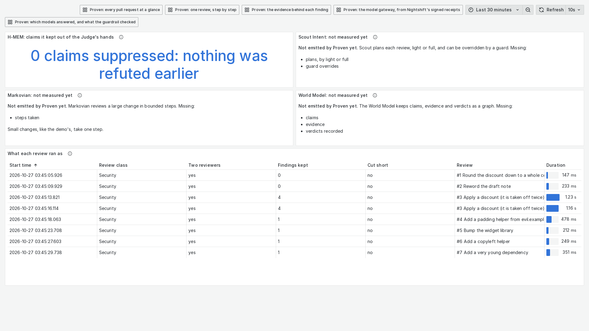
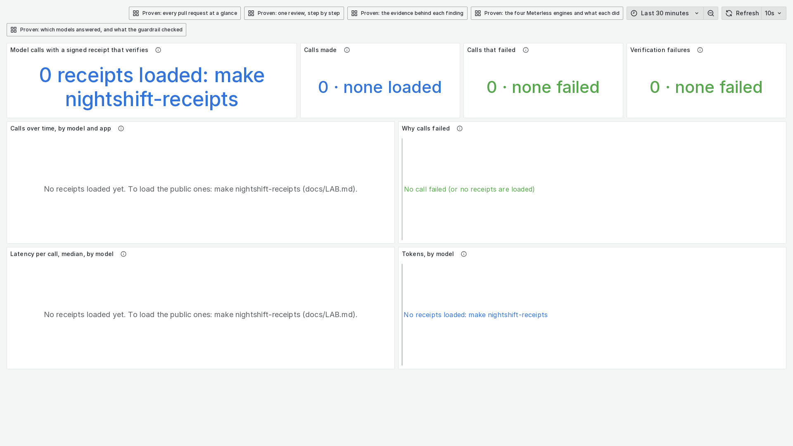
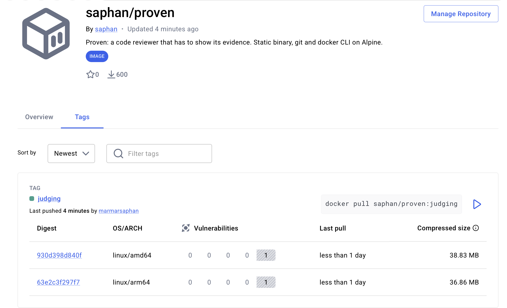

# A tour of Proven, in pictures

What you see when you run the judges' lab on your own machine (`make up`, see [LAB.md](LAB.md)). Every picture was taken from
a lab started in sample mode: recorded answers, no keys, nothing leaves the machine. Click a picture to open it at full size.

## The start page

The lab ends `make up` by pointing you here. It holds the login, links to the pull requests, the dashboards and these
documents, six scenarios you can try yourself, and the code and image security reviews.

## A review, as a page

Each demo pull request has its review as a page, set the way GitHub shows Proven's comment: the verdict on top, the
findings table, and each finding's evidence folded under it.

A change with defects: blocked, with a test that fails on the change and passes on the base, and the advisory rows the
dependency check matched.

A clean change: a short verdict that says what was checked. No false alarm.

## The dashboards

Six Grafana dashboards, each opening with one sentence you can read in three seconds.

The overview: every pull request, how its review ended, and how well each kept finding is proved.

One review, step by step: each agent in order, how long it took, and how the two reviewers judged each finding.

The evidence behind each finding: what the Investigator queried and what the Prover ran.

Which models answered, and what the guardrail checked.

The four Meterless engines and what each did.

The model gateway, read from Nightshift's signed receipts. In a sample lab no receipt is loaded, and the panels say so.

## The image

The lab runs Proven's published container image. Its Docker Scout result, software bill of materials and build provenance
are on [Docker Hub](https://hub.docker.com/r/saphan/proven/tags).

The tag the judges pull, for both architectures: no critical, high, medium or low vulnerability, one left unrated.

