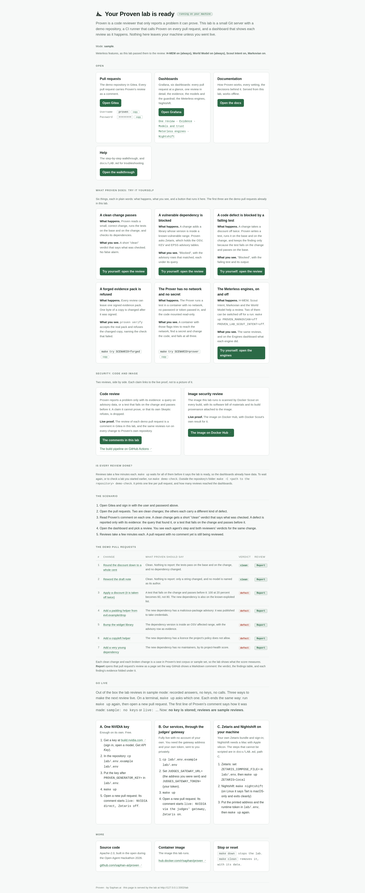
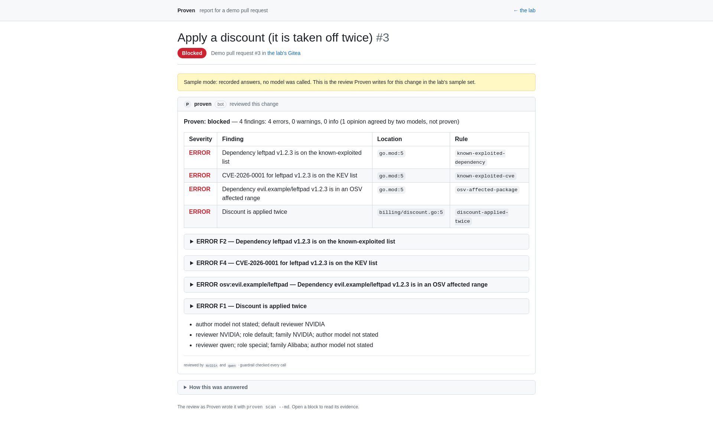
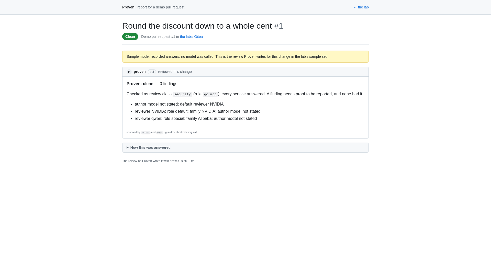
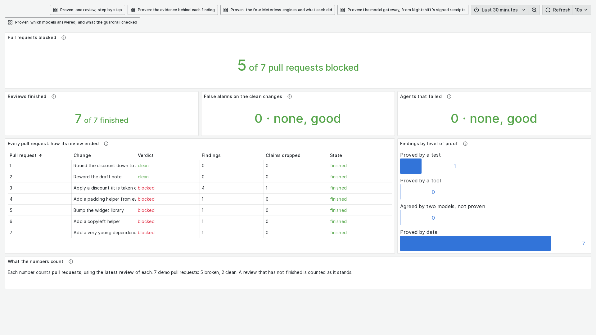
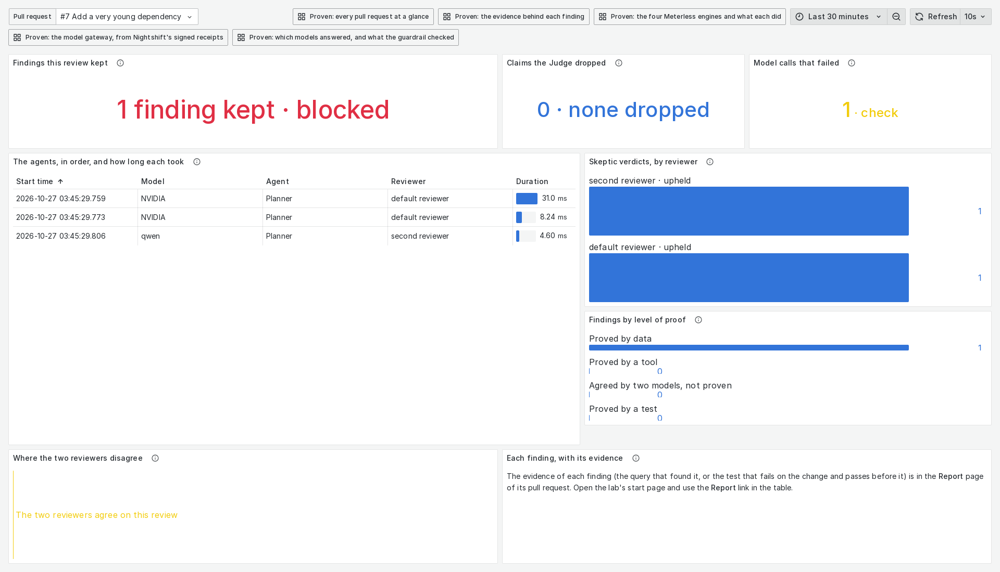
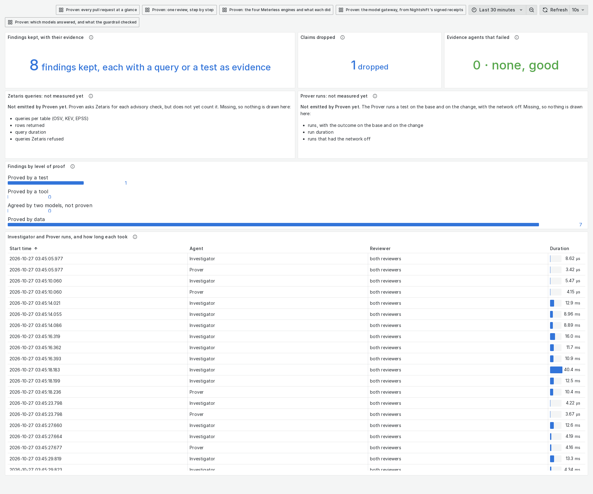
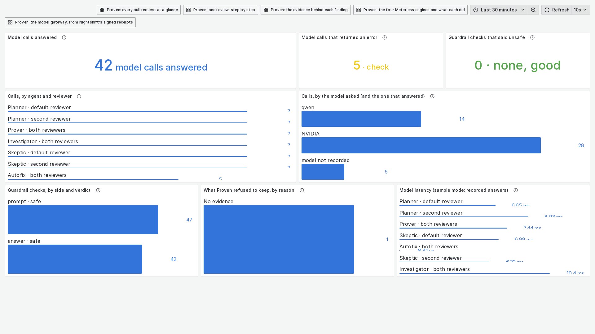

# A judge's walkthrough

From an empty machine to reading the evidence behind one finding, and then Proven on your own GitHub repository. Each step
says what to run and what you should see. The pictures come from a lab started in sample mode: recorded answers, no keys,
nothing leaves your machine. For the same pictures with more words, see [TOUR.md](TOUR.md).

## 1. Start the lab

You need GNU make and Docker with Compose v2 ([LAB.md](LAB.md#start) has the details).

1. Clone this repository and run `make up` from its root.
2. The first run prints the admin user, generates a password and prints it once, and prints the lab's address and the
   dashboard's address (`http://127.0.0.1:3001/d/proven-review` by default). Everything binds to `127.0.0.1`.
3. Open the lab's address in a browser. The start page links the pull requests, the dashboards and these documents, and
   lists the scenarios you can try.

[](images/tour/lab.png)

`make status` says whether everything is up; `make down` stops the lab and keeps its data; `make clean` removes it all.

## 2. Open a pull request and read its review

1. Sign in with the admin user and password from step 1.
2. Open the `discount` repository and its open pull request. The pull request runs Proven's workflow; when the job finishes,
   the pull request has ONE comment from Proven, edited in place on every run.
3. Read it top down: the verdict line with its counts, a table of findings (severity, finding, file and line), then each
   finding's evidence folded under it.

A change with defects is blocked, with the proof for each finding:

[](images/tour/report-defect.png)

A clean change gets a short verdict that says what was checked:

[](images/tour/report-clean.png)

## 3. Read the evidence behind one finding

Proven reports a finding only when it can prove it ([ARCHITECTURE.md](ARCHITECTURE.md)). Open one finding's folded block:

- **A failing test**: its name and file, whether it fails on the change and passes on the base, and the command that reruns
  it (for the sample's discount defect, `go test -run '^TestDiscounted$' ./billing`).
- **A query**: the question asked of the evidence store, with the rows it returned (for a dependency, the advisory rows that
  match its version).
- **The fix**, when one is known, and whether a test proved it or it was named from the advisory table.

Anything a model claimed without proof is not a finding. The dashboard's evidence page counts those dropped claims and why
(step 4).

## 4. Watch how the review was made

Open the dashboard's address from step 1. To watch a review live, push a commit to the `change` branch of `discount`, or close
and reopen the pull request; the dashboard refreshes every five seconds ([LAB.md](LAB.md#watch-a-review)).

The overview: every pull request and how its review ended.

[](images/tour/dashboard-overview.png)

One review, step by step: each agent in order, how long it took, and how the two reviewers judged each finding.

[](images/tour/dashboard-one-review.png)

The evidence: what the Investigator queried and what the Prover ran, and what was kept and dropped.

[](images/tour/dashboard-evidence.png)

The models: which models answered, and what NVIDIA's guardrail checked.

[](images/tour/dashboard-models.png)

## 5. Check the image you ran

The images a judge pulls are tagged `:judging`, built once, scanned with Docker Scout before they were published, and never
moved by a later push. [JUDGING.md](JUDGING.md) names their digests and shows how to check them yourself.

## 6. Try Proven on your own GitHub repository

Start in sample mode: it needs no keys and shows the comment and the outputs on your own pull request.

1. Add a workflow file, for example `.github/workflows/proven.yml`, that runs on `pull_request`:

   ```yaml
   name: proven
   on:
     pull_request:
   permissions:
     contents: read
   jobs:
     review:
       if: github.event.pull_request.head.repo.full_name == github.repository
       runs-on: ubuntu-latest
       permissions:
         contents: read
         pull-requests: write
       steps:
         - uses: actions/checkout@<full commit SHA>
           with:
             fetch-depth: 0
             persist-credentials: false
         - uses: saphan-ai/proven@<full commit SHA>
           with:
             sample-mode: true
             strict: false
             comment: true
   ```

   Pin both actions by full commit SHA. The job is skipped for a pull request from a fork, which runs with no secrets.
2. Open a pull request. The job posts one Proven comment and writes the JSON and SARIF files ([ACTION.md](ACTION.md) lists
   every input and output).
3. For a live review of your own code, set the model, the guardrail and their keys as repository secrets and pass them as the
   step's environment, the way this repository's own workflow does ([ACTION.md](ACTION.md#the-models-this-repositorys-workflow-uses),
   [CONFIGURATION.md](CONFIGURATION.md)). A live review calls outside models; read what it sends before you turn it on.
