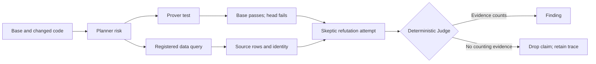

# Walkthrough: from a claim to its evidence

This walkthrough follows the recorded `discount` scenario. It shows how to read a result before connecting models or data. It uses the real decision pipeline with recorded outside responses, not a live correctness measurement.

## The change

The fixture contains `base/` and `change/` trees. The changed discount function subtracts the percentage twice: a price of 100 with a 20% discount becomes 60 instead of 80. It also raises a synthetic dependency into an affected range. These are separate evidence paths.

Run it with the commands in [Quick start](QUICKSTART.md), or run `make sample` from the Proven checkout. That target builds the CLI and runs outside its source tree.



## 1. Start with the verdict and coverage

The report's headline or findings count answers what was reported. Completion answers whether required analysis finished. A result with zero findings and an unavailable model is not the same as a complete result with zero findings.

In JSON inspect:

```sh
python3 - review.json <<'PY'
import json,sys
with open(sys.argv[1]) as f: r=json.load(f)
print('completion:', r['completion_status'])
print('findings:', len(r['findings']))
print('failed services:', r['failed_services'])
print('planning gaps:', r.get('unresolved_hypotheses', []))
PY
```

For this recorded fixture, expect complete coverage under its fixture plan, four findings and no failed services. This describes the recording and implemented rules, not the state of any real dependency with a similar name.

## 2. Follow the discount finding

Find `Discount is applied twice`. Its location points to `billing/discount.go`. The recorded test is `billing/discount_test.go`, `TestDiscounted`; the command is built as:

```text
go test -run '^TestDiscounted$' ./billing
```

Read both outcomes: `passes_on_base=true` and `fails_on_change=true`. A test that merely fails on both sides does not show a regression. A test that passes on both sides does not prove this claim. Sample mode replays those outcomes; [the runner](RUNNER.md) performs them for a live review.

The model proposed the test. Proven constructs its execution command and the Judge decides whether the recorded outcome counts. Confidence, persuasive wording or agreement between models cannot replace the differential result.

## 3. Follow a dependency finding

The dependency finding includes the registered `osv-by-package` query, source rows, ecosystem/package identity and the version comparison. Read the affected interval and the fixed boundary. The comparison is performed in Go by the ecosystem adapter; it is not a model's interpretation of the advisory.

A KEV row means the loaded snapshot lists the CVE. An EPSS row supplies a dated score. An empty KEV lookup says the imported table returned no match; it does not prove an absence of exploitation. A missing table is an analysis failure. [Source status](SOURCES.md) explains acquisition and freshness responsibilities.

## 4. Read the Skeptic and Judge separately

The Skeptic can propose a refuting query or test. The Judge checks the evidence and applies fixed rules. A model saying “not a bug” is not automatically a refutation. A denial row cannot override independently observed test/tool proof merely because it contains the word “clean”. Some query interpretation remains heuristic; see [readiness](READINESS.md).

The trace records `claim`, `evidence`, `refutation` and `verdict` events. Follow a finding ID through those events. Claims dropped for lack of evidence stay out of findings. Agreement between reviewers without proof can appear in a separate opinions section; it is not a proved defect.

## 5. Inspect a fix

A suggested source fix is shown as proved only after the same test passes on base, fails on head, passes on the patched head, and the patched package's tests pass. An advisory-derived dependency update is labelled as such and is not a test-proved source fix. The source under review is not committed or merged by Proven. See [Fixes](FIXES.md).

## 6. Inspect the run rather than guessing from its duration

Live `model-attempt` events include HTTP status, elapsed time, header and first-byte times, finish reason, answer/reasoning byte counts and available usage. A model can be actively reasoning while answer text is empty. A token limit is distinct from an idle timeout. The [observability guide](OBSERVABILITY.md) provides a small trace reader.

An `unresolved-hypothesis` event is a coverage gap, not a finding. Final gaps survive into reports while identified risks continue through verification. [Bounded planning](MARKOVIAN.md) explains when the overall result remains incomplete.

## 7. Try the controls

Use the sibling fixtures to distinguish recording behavior:

| Fixture | What to inspect |
| --- | --- |
| `discount-clean` | No kept finding for the recorded corrected change. |
| `refuted` | A candidate that the Skeptic's evidence refutes. |
| `fix` | A proposed fix and its validation outcomes. |
| `unsafe-prompt` | A recorded safety-service refusal. |
| `autofix-fixed` / `autofix-rejected` | A single whole-change fix attempt and its accepted/rejected result. |

Run `proven scan --sample /absolute/path/to/testdata/fixture/<name>` from a separate run directory. The detailed [sample guide](SAMPLE_MODE.md) describes the scenarios and fixture format. The next live, account-free exercise is the [data walkthrough](DATA_WALKTHROUGH.md).
