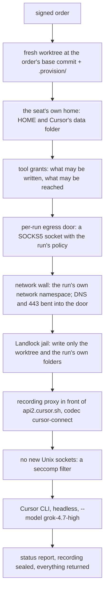

# Cursor: how Proven is coded with it

Proven's product code is written by **Cursor agents**. If you use Cursor in your editor, this is not quite what you know. Nobody sits in front of a Cursor window. Each agent runs **unattended, on a remote Linux machine**. It gets a written order, works on its own copy of the repository, and returns a report. Then other agents check its work, and a human approves it before it is merged.

This page explains how that works, step by step, with the actual commands and configuration. Who does what in the fleet is explained in [SAPHAN.md](../../../SAPHAN.md); the other technologies' setups are in [`fleet/infra/`](../README.md).

## In one paragraph

[Saphan Studio](https://saphan.ai/) runs the Cursor agent as one of its **backends**, next to Claude Code, Codex and others. A **master** (a coordinating agent) writes an order for one small change. The owner signs it. Saphan Studio places the run on a free **Cursor seat**: one Cursor account, logged in on one machine. It starts Cursor's command-line agent there, headless, in a fresh copy of the repository, inside a sandbox whose only way out is Saphan Studio's **recording proxy**. Every request the agent makes to its model passes through the proxy and is recorded. When the agent is done, the master verifies the result on another machine. Two independent reviewers check it, one of them always an NVIDIA Nemotron model. The owner decides whether it is merged.

## What a Cursor agent may and may not do

| | |
|---|---|
| **may** | read and write files in its own copy of the repository; run the build, the tests and the tools its permission class allows (Go, Python, Node, gcc); commit to its own branch |
| **may not** | reach the internet: its only route out is the recording proxy, which lets through only the model's traffic (`api2.cursor.sh:443`) and what its order names, such as the Go module proxy; read any data source directly (evidence comes through Zetaris, tests use recorded fixtures); hold any credential of Proven's data sources or model providers; merge anything; review its own work |
| **model** | Grok 4.7, effort `high` (`grok-4.7-high`), named explicitly on every run; Cursor's `auto` is refused, because it may switch to another vendor's model |

## The life of one change

1. **Order.** The master writes an order for one change: what to build, how it will be checked (the *definition of done*), and what is out of scope. Every order is public in [`fleet/orders/`](../../orders/).
2. **Signature.** The owner signs the order. A signature binds the exact bytes, so an order cannot change after it is signed. If it must change, its master amends it and the owner signs it again.
3. **Placement.** Saphan Studio picks the seat. It reads every admitted Cursor seat's state and prints why the winner won.
4. **Run.** The Cursor agent works on the remote machine, behind the proxy. Every model request is recorded ([ADR-0024](../../decisions/ADR-0024-every-cursor-coding-session-is-recorded-and-published.md)).
5. **Report.** The agent writes its status report: what it built, what it ran, what failed, and what it could not check.
6. **Verify.** The master checks the result out at the exact commit, on a different machine, and runs the build and the full test suite again. It does not trust the agent's report.
7. **Review.** Two independent reviews of the same diff run in parallel, and neither sees the other's verdict. One is always an NVIDIA Nemotron model through Meterless Nightshift, with a signed receipt per request. The other is a different model family.
8. **Decision.** The owner reads the reviews and decides. Only the owner merges.

## What happens when a Cursor run starts

In the editor, Cursor runs on your machine with your files and your network. Here, Saphan Studio first builds a closed
room on runner-cursor, and only inside that room is Cursor's command-line agent started. The steps, in the order they
happen:



1. **A fresh worktree.** The engine checks the repository out on runner-cursor at the exact commit the order names as
   its base, on the order's own branch. What the agent must read (the order, its role's craft notes, the skills the
   order names) is copied into `.provision/` inside it. Nothing else of the fleet's records is on that machine.
2. **The seat's own home.** The run's `HOME` is the seat's directory, so it uses that seat's Cursor login and nothing
   else. Only `HOME` and `PATH` are passed in; Cursor's endpoint variables are never forwarded, so the agent cannot be
   pointed past the proxy.
3. **Tool grants.** Every leg runs under a permission class chosen from its role and its work. For a Go change on a
   Cursor seat today that is the executor class with two workloads added: Go (`proxy.golang.org`,
   `sum.golang.org`) and npm (`registry.npmjs.org`). For Cursor the grant is enforced by the machine, not by Cursor's
   own settings: what may be written is the jail's write list (step 6), and what may be reached is the door's policy
   (step 4). Cursor itself runs with `--trust --sandbox disabled`, because the boundary sits outside it. A grant is
   always the owner's act, and it reaches only the run it is provisioned to.
4. **The egress door.** A per-run door starts first: a SOCKS5 socket in the run's own private folder, which the agent
   cannot write. It judges every connection against the run's policy and books each decision. The policy a proven
   Cursor run used today (`baseline-cursor-v1+egress-workload-go-v1+egress-workload-npm-v1`):
   ```json
   {"id": "vendor-cursor-model-endpoint-proxy-upstream", "hosts": ["api2.cursor.sh"], "ports": [443], "verdict": "allow"},
   {"id": "workload-go-go-module-proxy", "hosts": ["proxy.golang.org"], "ports": [443], "verdict": "allow"},
   {"id": "workload-go-go-checksum-database", "hosts": ["sum.golang.org"], "ports": [443], "verdict": "allow"},
   {"id": "workload-npm-npm-registry", "hosts": ["registry.npmjs.org"], "ports": [443], "verdict": "allow"}
   ```
   Anything not on the list is refused.
5. **The network wall.** The agent gets its own network namespace. Inside it, DNS and port 443 lead only to the door,
   so a program that ignores proxy settings still cannot get out another way. Host sockets outside the kept paths are
   masked.
6. **The Landlock jail.** The whole file system stays readable for the toolchain, but writes are allowed only to the
   worktree, the run's own artifact folder, the seat's session folder and `/dev/null`. Go's caches are placed inside
   the worktree for the same reason.
7. **The recording proxy.** A proxy listens on a loopback port and is the only path to Cursor's model API. It decodes
   Cursor's protocol (`cursor-connect`) and records every request and answer. The seat's Cursor settings force
   HTTP/1.1 (`network.useHttp1ForAgent: true`) so the proxy can read the traffic.
8. **No new Unix sockets.** A seccomp filter forbids the agent from creating a Unix socket, so it cannot open a side
   channel to another process on the machine.
9. **Cursor starts.** Only now does the engine run Cursor's CLI, headless, with the standing laws and the order as
   its prompt:
   ```
   agent -p --output-format stream-json --trust --sandbox disabled --disable-auto-update \
     --model grok-4.7-high -e http://127.0.0.1:<proxy port> --agent-endpoint http://127.0.0.1:<proxy port>
   ```
   The order's wall time is the only bound on the run: Cursor is a subscription, so no dollar cap applies.
10. **The end.** The agent writes its status report (`_EXEC_STATUS.md`) and commits to its branch. The engine closes
    the door, seals the recording, and brings the branch, the report, the recording and the door's decisions back to
    the orchestrating machine, where the master verifies them.

**One real run.** `run-20261022-073935-b03091ec`, 22 October 2026, seat `cursor-fleet-3-1` on runner-cursor, model
`grok-4.7-high`, change *cli-over-the-sample-reviewer*, round 3. It ended `ok` and returned branch commit `2d600b4`.
The door booked two decisions, both permitted: `api2.cursor.sh:443` (the model, through the proxy) and
`registry.npmjs.org:443` (the npm workload). The recording came back as 5 files, 920 308 bytes.

## A Cursor seat: the setup

A **seat** is one Cursor account on one machine, in its own home directory, so its login and session files never mix with
another account's. Four accounts are seated on runner-cursor, one on macm5. Seating is the owner's act:

```bash
saphan machine seat --identity cursor-fleet-3-1 --machine runner-cursor --slot 1 \
  --role executor --backend cursor --billing-class subscription \
  --config-dir '$HOME/.cursor-fleet-3-1'
saphan machine set-account --identity cursor-fleet-3-1 --account cursor-2df82fef6b0f1509
saphan config set probe.model.cursor grok-4.7-low,grok-4.7-medium,grok-4.7-high,grok-4.7-xhigh
```

- **role** `executor`: these seats write proven's code; reviews run on other model families.
- **billing class** `subscription`: Cursor's plan pays, so the scarce thing is the account's allowance; no dollar cap
  stops a run — the order's wall time does.
- **account**: an opaque digest that tells the scheduler which seats share one Cursor account. Four seats, four accounts.
- **model**: Grok takes its effort in its name: `grok-4.7-high` by default, `-medium` or `-xhigh` when an order says so.
  The bracket form `grok-4.7[effort=high]` is refused by Cursor's CLI for Grok (measured 22 October).
- **the seat's Cursor settings** (`.cursor/cli-config.json` in its home): `network.useHttp1ForAgent: true`, so the
  agent's traffic is HTTP/1.1 that the recording proxy can read.
- **network**: closed. Inside the run's own network namespace, DNS and port 443 go to a per-run door that admits only
  Cursor's own host; everything the agent sends to Cursor passes the recording proxy first (codec `cursor-connect`).
- **confinement**: Landlock on Linux; the agent can write only its copy of the repository and its own seat files, and
  cannot read the seat's key or the machine's key.

## Running one change: the commands

<!-- DRAFT: filled from the reviewer train master's answer 818c8bdf84310f1b -->

## What it costs

<!-- DRAFT: filled from the reviewer train master's answer 818c8bdf84310f1b -->

## Where it runs today

| shape | state, 22 October 2026 |
|---|---|
| native Linux, far — runner-cursor, 4 seats | **in use**: every Cursor wagon of the build runs here |
| Docker on runner-cursor | **not built**: a container boundary is composed only for local runs; the Go + Python image waits in [`../go-python/`](../go-python/) |
| macm5, local — 1 seat | seated and confinable; not yet used by a build wagon |
| macmini, far | not seated: a Cursor login over ssh fails at the macOS keychain, and a far seat's API key has no carrier yet |
